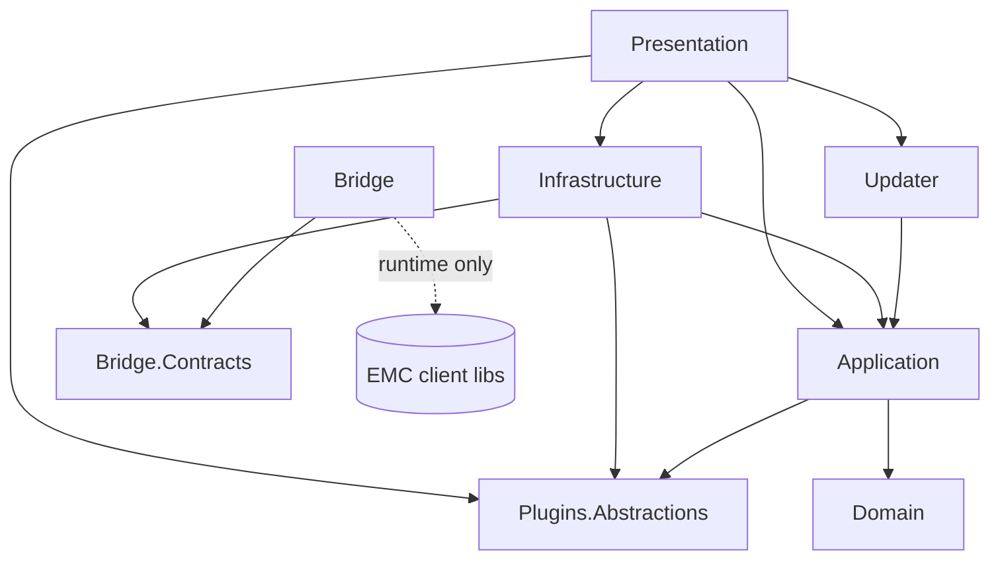

# EMC Companion


> Master project charter. Owner: NyxionSoftware. Copyright (c) 2026 NyxionSoftware (https://nyxionsoftware.com).

EMC Companion is a passion project by NyxionSoftware: a modern, themeable, plugin-capable desktop companion for the Oracle Simphony Enterprise Management Console (EMC). A small .NET Framework **Bridge** process loads the EMC client libraries that are already installed on the user's machine, talks to Simphony on the app's behalf, and translates the results into a versioned contract that the 64-bit **.NET 10 WPF** application can read, understand, and edit. EMC Companion never ships, copies, or redistributes any Oracle component. Without a licensed, locally installed EMC client it does nothing. On top of EMC parity it adds what administrators have wanted for years: a clean Claude-inspired interface with Light and Dark modes and three themes, a safe pending-change model, hierarchy awareness, formatted exports, inspection tools, in-app updates, a themed installer, and a live-loading plugin API.

This document is the single source of truth for scope, rules, architecture, and the batch-by-batch roadmap. Work proceeds in small batches: build a small feature, the owner edits/tests/gives feedback, then the next batch begins.

---

## Table of Contents

1. [Overview](#1-overview)
2. [Legal and Clean-Room Policy](#2-legal-and-clean-room-policy)
3. [Accomplishments So Far](#3-accomplishments-so-far)
4. [Vision and Design Principles](#4-vision-and-design-principles)
5. [v1.0.0 Goals](#5-v100-goals)
6. [Architecture](#6-architecture)
7. [Coding Standards](#7-coding-standards)
8. [UI/UX and Theming](#8-uiux-and-theming)
9. [Updates](#9-updates)
10. [Installer](#10-installer)
11. [Plugin System](#11-plugin-system)
12. [EMC Parity Map](#12-emc-parity-map)
13. [Security and Privacy](#13-security-and-privacy)
14. [Testing and QA](#14-testing-and-qa)
15. [Workflow](#15-workflow)
    - [15.8 Claude Code plugins and tooling](#158-claude-code-plugins-and-tooling)
16. [Roadmap](#16-roadmap)
    - [Roadmap tracking in Trello](#roadmap-tracking-in-trello)
17. [Open Questions and Decisions](#17-open-questions-and-decisions)
18. [Glossary](#18-glossary)
19. [Appendix](#19-appendix)

---

## 1. Overview

### 1.1 What it is

EMC Companion is a Windows desktop application that lets Oracle Simphony administrators view and maintain their enterprise configuration through a reimagined interface built on modern .NET. It is a "companion" in the literal sense: it sits next to an existing EMC client installation and uses that installation's libraries through the Bridge. It is a build-on of EMC's ideas, not a fork of EMC's code.

| Item | Value |
|---|---|
| Project name | EMC Companion |
| Author / owner | NyxionSoftware (personally owned; not affiliated with any employer) |
| Copyright | Copyright (c) 2026 NyxionSoftware (https://nyxionsoftware.com) |
| App platform | .NET 10, WPF, Windows 10 or later, 64-bit |
| Bridge platform | .NET Framework 4.8 (minimum 4.6.2 compatible), x64 by default (`BridgePlatform=x86` build switch kept until M1.3 verifies x64 with a live sign-in) |
| Target EMC | Simphony EMC client 19.10.2.0.27 (`EMC.exe` is an AnyCPU .NET Framework 4.6.2 executable with a WinForms UI; it runs 64-bit on x64 Windows) |
| Repository | public `NyxionSoftware/EMC-Companion`; legacy private repo `EMC-Companion-Legacy` |
| Lineage | Continues the version line of the owner's "EMC Export Utility" (v0.7.1) and the private .NET 8 "EMC Companion" iteration, which now lives in the private `EMC-Companion-Legacy` repo |

### 1.2 Who it is for

- **Simphony administrators** who spend their day in EMC maintaining menu items, classes, page designs, devices, and descriptors across an Enterprise, its Zones, Properties, and Revenue Centers.
- **Implementation and support staff** who need to inspect, compare, and export configuration quickly and safely.
- **Power users and developers** who want to extend the tool with plugins (custom exporters, inspectors, workspaces, themes).

### 1.3 What it is not

- **Not a replacement for EMC.** EMC remains the authoritative Oracle tool. EMC Companion depends on it.
- **Not a redistribution of EMC.** No Oracle DLLs, executables, resources, fonts, images, or decompiled source are ever included in the repository, the installer, releases, or plugins.
- **Not a licensing workaround.** A properly licensed EMC client install and valid Simphony credentials are required. All access goes through the same permissions and role checks EMC applies.
- **Not a cloud service.** It is a local desktop tool. No telemetry by default, no hosted backend.
- **Not affiliated with or endorsed by Oracle.** See NOTICE in section 2.6.

### 1.4 How it works in one picture

```
+-------------------------------+        named pipe (local, per user)       +-------------------------------+
| EMC Companion (.NET 10, x64)  | <--------- versioned JSON contract -----> | EMC Companion Bridge          |
| WPF UI, themes, plugins,      |                                            | (.NET Framework 4.8, x64)     |
| pending changes, exports      |                                            | loads EMC libs from the       |
+-------------------------------+                                            | user's EMC install folder     |
                                                                             +---------------+---------------+
                                                                                             |
                                                                                             v
                                                                             +-------------------------------+
                                                                             | Licensed EMC client install   |
                                                                             | C:\Program Files\Oracle       |
                                                                             | Hospitality\EMCClient\        |
                                                                             +---------------+---------------+
                                                                                             |
                                                                                             v
                                                                                 Simphony application server
```

---

## 2. Legal and Clean-Room Policy

This section is binding for every contributor, every automated agent, and every batch. When in doubt, do not commit.

### 2.1 Oracle files are never committed

| Never commit | Examples | Enforcement |
|---|---|---|
| Oracle binaries | `*.dll`, `*.exe`, `*.pdb` from the EMC folder, DevExpress assemblies | `.gitignore`, pre-commit hook blocks binaries outside `assets/`, CI check |
| Decompiled source | Any C# or IL produced by a decompiler | Clean-room rule (2.2), review checklist |
| Oracle resources | Icons, images, fonts, XAML/resx, help files, configuration templates | Asset provenance file (`assets/PROVENANCE.md`) |
| Oracle documentation copies | PDFs, screenshots of Oracle docs | Link to public URLs instead |
| Customer data | Database exports, real menu items, property names, employee data | Sample dataset only (2.5) |
| Environment details | Hostnames, IPs, URLs of real servers, usernames, passwords, tokens | Secret scanning (2.4) |

The Bridge references EMC assemblies **at runtime only**, by probing the configured EMC install folder. At build time the Bridge compiles against a thin reflection or `dynamic` adapter layer, or against reference stubs that the developer generates locally into an ignored folder (`lib/emc/`, listed in `.gitignore`). CI never needs Oracle files: Bridge adapter code that touches EMC is isolated behind interfaces and compiled with a build constant (`EMC_LIBS`) so that CI builds the fake adapter only. See 6.5.

### 2.2 Clean-room rule for REA (Reverse Engineer Anything)

The owner uses REA (the owner's local REA tooling) to decompile and deeply understand EMC's behavior and UX. The output of that work is **knowledge**, never code.

Rules:

1. REA runs **only on the owner's workstation** against the owner's licensed dev copy at `%USERPROFILE%\source\repos\Oracle Hospitality\EMCClient\`.
2. Decompiled output stays **outside the repository** (for example `%USERPROFILE%\REA-Notes\`), never in a cloned working tree, never in a scratch folder inside the repo.
3. Notes that enter the repo (`docs/emc/`) **describe behavior**: what a screen shows, which fields exist, what validation happens, what order operations run in, what EMC refuses and why, which API surface (type and member names) the Bridge must call. They never paste decompiled method bodies, IL, or resource contents.
4. Type and member names that the Bridge must call are interoperability facts and may be recorded (for example "the menu item master collection is loaded through the configuration service by object number range"). Implementation details are rewritten in our own words.
5. Implementation in EMC Companion is written fresh, in the owner's style, from the behavior notes. Whoever writes Bridge code should work from `docs/emc/` notes, not from an open decompiler window.
6. Every PR that touches the Bridge or adds EMC behavior includes the checkbox: "No decompiled code, Oracle assets, or customer data are included."
7. If a contributor is unsure whether something is behavior or code, it is treated as code and stays out.

### 2.3 Trademarks

Oracle, Simphony, and MICROS are trademarks of Oracle and/or its affiliates. DevExpress is a trademark of Developer Express Inc. Claude and Anthropic are trademarks of Anthropic, PBC. Apple, iOS, and Liquid Glass are trademarks of Apple Inc. EMC Companion uses these names only nominatively, to describe compatibility or design inspiration. Themes named "Claude", "EMC", and "Glass" describe a visual direction; they use no proprietary assets:

- No Anthropic fonts, logos, or icon files. The Claude theme uses open fonts and Lucide icons (ISC license) chosen to evoke a similar warm, calm feel.
- No Oracle icons, images, or skins. The EMC theme is a fresh recreation of EMC's design philosophy (dense, grey, ribbon-like toolbars, blue selection) using our own drawings.
- No Apple assets. The Glass theme uses Windows-native Mica/Acrylic and our own blur and gradient layers.

The app name "EMC Companion" describes compatibility with EMC. The About box and README state that the project is independent and not affiliated with, sponsored by, or endorsed by Oracle.

### 2.4 Public-repo secret hygiene

| Control | Detail |
|---|---|
| `.gitignore` | Ignores `bin/`, `obj/`, `publish/`, `artifacts/`, `lib/emc/`, `*.user`, `appsettings.Local.json`, `*.pfx`, `*.snk` (unless public), `logs/`, `TestResults/`, `screenshots/raw/` |
| User secrets | Developer-only values (test server URL for integration tests) live in `dotnet user-secrets` or environment variables, never in tracked files |
| Settings beside exe | Runtime settings live in `settings.json` beside the exe or in `%APPDATA%\NyxionSoftware\EMC Companion\`; neither is tracked |
| Pre-commit scan | `ggshield` (GitGuardian) pre-commit hook recommended, with `gitleaks` as an offline alternative; config in `.pre-commit-config.yaml` |
| CI scan | GitHub secret scanning plus push protection enabled on the repo; GitGuardian app on PRs; `gitleaks` job in CI as a backstop |
| Placeholders | Test placeholders must not look like real secrets. Use `example.invalid` hosts and obviously fake values like `not-a-password`. Lesson learned: a realistic placeholder triggered GitGuardian in the old repo and forced a squash into a fresh PR |
| Signing keys | Code-signing certificates live only in GitHub Actions secrets or a hardware token; never in the repo |
| Logs | Logs are scrubbed (section 13) and never attached to issues without review |
| History | If anything sensitive ever lands, rotate the secret first, then rewrite history; treat the secret as compromised regardless |

### 2.5 Sample data only

Screenshots, tests, docs, and the screenshot harness use a fictional dataset (`samples/Contoso Grill` or similar, see 14.4). Names, object numbers, and prices are invented. Real enterprise names, property names, employees, or server names are never used, including in commit messages, issue text, or PR descriptions.

### 2.6 NOTICE file (draft)

```
EMC Companion
Copyright (c) 2026 NyxionSoftware (https://nyxionsoftware.com)

EMC Companion is an independent project. It is not affiliated with, sponsored by,
or endorsed by Oracle Corporation or its affiliates.

Oracle, Simphony, and MICROS are trademarks or registered trademarks of Oracle
and/or its affiliates. Other names may be trademarks of their respective owners.

EMC Companion does not include, bundle, or redistribute any Oracle software,
libraries, documentation, images, or other materials. It requires a separately
licensed and installed Oracle Simphony EMC client, which it loads at runtime
from the location configured by the user. Use of the EMC client remains subject
to the user's agreement with Oracle.

Third-party open-source components and their licenses are listed in
THIRD-PARTY-NOTICES.md.
```

### 2.7 License recommendation (owner to decide)

The previous private repo was proprietary. A public repo needs an explicit choice; without a license, the code is visible but "all rights reserved".

| Option | Effect | Fit |
|---|---|---|
| **MIT** | Very permissive; anyone may reuse, including commercially | Good for adoption and plugin authors; least control |
| **Apache-2.0** | Permissive plus explicit patent grant and NOTICE handling | Recommended if permissive: NOTICE file pairs naturally with the Oracle disclaimer |
| **GPL-3.0** | Copyleft; derivatives must stay open | Protects against closed forks; plugin licensing gets complicated |
| **MPL-2.0** | File-level copyleft; plugins can be any license | Good middle ground for a plugin ecosystem |
| **Source-available / proprietary** (all rights reserved, or PolyForm Noncommercial) | Code visible, reuse restricted | Keeps control; discourages contributions |

Recommendation: **Apache-2.0 for the app**, with `EmcCompanion.Plugins.Abstractions` and `EmcCompanion.Bridge.Contracts` under the same license so plugin authors may license their plugins however they want. If the owner prefers control, choose PolyForm Noncommercial 1.0.0 and state that clearly in the README. Decision tracked in section 17.

---

## 3. Accomplishments So Far

The previous iteration (legacy repo `NyxionSoftware/EMC-Companion-Legacy`, private, .NET 8 WPF, PRs #1 through #56, October 19 to 24, 2026) proved the concept end to end. Its behavior, specs, and lessons are the foundation for the new public repo. Code is rewritten into the new layered architecture rather than copied wholesale, but behavior is carried over exactly unless this document says otherwise.

### 3.1 Feature foundation

| Area | What was achieved | Carry-over decision |
|---|---|---|
| Launch | Finds EMC at the default path; otherwise shows an in-window modal and a manual directory picker | Keep; move validation into Application layer |
| Settings | Settings per app instance, editable in-app or in a settings file beside the exe | Keep, add per-user override layer (6.10) |
| Sign-in | Sign-in window with show-password eye toggle | Keep; rebuild eye toggle without mouse capture (3.3) |
| Shell | Hierarchy tree (Enterprise > Zones > Property > Revenue Center), Home with one search field above section tabs, File/Edit/View/Help menus with icons, EMC-style toolbar, keyboard shortcuts, Find (Ctrl+F), help | Keep layout; restyle per theme |
| Home sections | Enterprise and Property show Configuration, Setup, Descriptors, Tasks; Revenue Center and Zone show Configuration, Setup, Descriptors | Keep rule (Appendix 19.1) |
| Module tiles | Tiles per level from the owner's spec, respecting Enterprise-level disabled modules and role view access; unbuilt modules show "not built yet" | Keep; tiles become a registry that plugins can extend |
| Workspaces | Open in Table view; double-click or toggle opens Form view | Keep |
| Pending changes | Edited rows yellow, pencil on unsaved tabs, Save writes only the tab in view, Save All covers only the module in front, Undo and Reload, navigation never implicitly saves, a new search asks before discarding edits | Keep exactly; formalize in Application layer (6.7) |
| Live-write safety | "Save to EMC" off by default; first live write requires owner OK and a test item | Keep as a hard rule |
| Hierarchy-aware records | Records defined or overridden at the selected level are editable; inherited ones are view-only with a banner and an "Open at <level>" button | Keep |
| Menu Item Maintenance | Search pane, filters, table; Master/Definition/Price tabs; cross-tab navigation; in-table editing; context-aware Insert; rich form view (see 12.3) | Keep; first parity module of v1 |
| Menu Item Classes | Table with about 35 editable columns, form matching EMC (General, Options bits, Condiment Groups, Forced Condiments thresholds to 8), copy/paste/insert as drafts | Keep |
| Print Classes | Same draft tools as Menu Item Classes | Keep |
| Descriptors | Tables for SLU names, condiment group names, and more, with jump arrows | Keep |
| Page Design | Nearly identical to EMC plus extras: Inspect button inside SLUs, style picker with General/Special/Custom tabs rendering each style on a real button, device presets with "Set as default", zoom, Grid overlay with Layout row, debug info behind a setting | Keep; Inspect becomes a plugin-extensible inspector |
| Devices | Workstations and Printers tables started | Continue |
| Exports | Every form exportable as formatted Excel, not raw dumps | Keep; exporter pipeline becomes pluggable |
| Docs | README with real screenshots drawn by the app from sample data via a screenshot harness; CHANGELOG (Keep a Changelog); `docs/VERSIONING.md`, `docs/ROADMAP.md`, `docs/EMC-REFERENCE.md`, specs, `TESTING.md` with per-batch "What to test" | Keep and expand |

### 3.2 Deliberately not built yet

- **Menu item Delete.** Planned: immediate (not pending), confirmation every time, shows EMC's refusal reasons verbatim (for example sales history). Deferred because it writes live. Rule: never delete menu items with sales history; EMC's refusal is surfaced, not bypassed.

### 3.3 Lessons learned (carried forward as rules)

| Lesson | Rule in the new repo |
|---|---|
| The show-password eye locked focus: after clicking it, nothing else was clickable until Tab. Two fix attempts (#49, #50) | Never use mouse capture for toggles. Move focus to a stable element before hiding or collapsing a focused control. Test with real mouse and keyboard input, not only automation. Add a UI regression test for "click eye, then click Sign In" |
| Stacked PRs merged into each other instead of `main-dev` | After each merge, retarget remaining PRs to `main-dev`. Prefer one PR per batch; if stacking, note the base in the PR body and verify before merge |
| GitGuardian flagged a test placeholder | Use obviously fake placeholders (2.4). If a scan fires, squash into a fresh PR and rotate if real |
| Opening the app on the owner's PC during automated work interrupts the owner | Automated agents never launch the app visibly on the owner's workstation. UI tests and screenshot harness run hidden/off-screen |
| Remote Control sessions cannot receive uploads | Ask the owner for files through the repo (issue attachment or a branch) or a local path, not uploads in a Remote Control session |
| Screenshots drawn from sample data looked real and stayed current | Keep the screenshot harness and regenerate screenshots in each release batch |

### 3.4 Environment facts established

- EMC client: Simphony EMC 19.10.2.0.27. `EMC.exe` is an AnyCPU .NET Framework 4.6.2 executable and runs 64-bit on x64 Windows. Its UI is WinForms. The 32-bit, DevExpress 17.1 tool in the same folder is LDSConfigurator, not EMC.
- The Bridge exists because EMC's libraries are .NET Framework assemblies with WinForms and web-service dependencies that .NET 10 cannot host. Bitness is not the reason.
- EMC's sign-in flow includes a self-update step that rewrites the EMC install folder (the Bridge rule is in 6.4).
- EMC's session client is static, so one Bridge process holds exactly one EMC session (matches 6.4).
- The owner's workstation holds the Oracle dev copy: `%USERPROFILE%\source\repos\Oracle Hospitality\EMCClient\`.
- EMC concepts: Enterprise > Zones > Property > RVC, top-down inheritance with overrides.

---

## 4. Vision and Design Principles

### 4.1 Vision

Give Simphony administrators the EMC they would design for themselves: everything EMC can do in the modules they use daily, behaving the way they already expect, but faster to navigate, safer to edit, pleasant to look at, easy to export from, and open to extension.

### 4.2 Principles

| # | Principle | What it means in practice |
|---|---|---|
| P1 | **EMC parity first, then improve** | A module is not "done" until an EMC user can do the same job without surprises. Improvements are layered on top and never change what a field means |
| P2 | **Table first, form second** | Workspaces open in a dense, editable Table view. Double-click or toggle opens a Form view for one record. Both share the same pending-change state |
| P3 | **Pending-change safety** | Edits are drafts until saved. Edited rows are highlighted, tabs show a pencil, Save is scoped to the tab in view, Save All to the module in front. Navigation never saves implicitly. Destructive discards always ask |
| P4 | **Never write live without explicit opt-in** | "Save to EMC" is off by default. Turning it on is a deliberate setting with a warning. First live write in a new module is done with a test item and owner approval |
| P5 | **Hierarchy awareness** | Every record shows where it is defined. Inherited records are view-only with a banner and an "Open at <level>" jump. Overrides are explicit |
| P6 | **Simplicity** | One search field per Home. Clear labels. No hidden modes. Defaults that work. Settings are discoverable and few |
| P7 | **Exportability** | Every table and form can be exported in a presentable format (formatted Excel, CSV, and later PDF), with headers, widths, and grouping |
| P8 | **Respect EMC's rules** | Role permissions, disabled modules, and EMC's validation are honored. EMC's refusal messages are shown verbatim |
| P9 | **Local and private** | No telemetry by default. No credentials in plain text. Logs scrubbed |
| P10 | **Extensible by design** | Modules, exporters, inspectors, commands, settings pages, and themes are registered through the same registries plugins use |
| P11 | **Write code as if the owner wrote it** | Consistent style (section 7), readable, block namespaces, short meaningful names |
| P12 | **Small batches** | Every change is small enough to test in one sitting and to describe in a short "What to test" list |
| P13 | **Honest by design** | No dark patterns. Every opt-in is off by default. Cancel, decline, and "Later" are as prominent as confirm. No confirmshaming copy, no pre-checked boxes, no nagging. Destructive actions are labeled plainly. Turning a feature off is as easy as turning it on |

---

## 5. v1.0.0 Goals

v1.0.0 is the first public stable release. Each goal has acceptance criteria (AC) that must all be checked before tagging `v1.0.0`.

### 5.1 Goal G1: Modern Claude-style UI with themes

A calm, warm, modern interface inspired by the Claude Code desktop app, with Light and Dark modes and three themes at launch: **Claude** (default), **EMC**, and **Glass**.

Acceptance criteria:

- [ ] Theme engine loads themes from manifests; switching theme or mode applies live without restart.
- [ ] Three themes ship: Claude (default), EMC, Glass, each in Light and Dark.
- [ ] Mode options: Light, Dark, Follow Windows (default). Follows changes to the Windows setting while running.
- [ ] No proprietary fonts or icons: Lucide icons (ISC), open fonts bundled under SIL OFL with licenses in THIRD-PARTY-NOTICES.md.
- [ ] Every built-in control (buttons, text boxes, combo boxes, check boxes, data grid, tree, tabs, menus, tooltips, dialogs, scroll bars) is styled in all six theme/mode combinations.
- [ ] Contrast for body text meets WCAG 2.1 AA (4.5:1) in all six combinations; non-text UI (focus ring, input borders, icons, selected state) meets 3:1 (WCAG 2.1 1.4.11) in all six combinations; verified by a test that checks theme token pairs.
- [ ] Glass theme falls back gracefully on Windows 10 (no Mica) and when "Transparency effects" is off.
- [ ] Theme choice persists per user.

### 5.2 Goal G2: Update-ability

The app checks for updates, can update itself, and shows patch notes in-app from GitHub Releases.

Acceptance criteria:

- [ ] Checks GitHub Releases on startup (configurable) and on demand (Help > Check for Updates).
- [ ] Shows available version, size, and rendered release notes before updating.
- [ ] Downloads the installer, verifies SHA-256 from the update manifest (and Authenticode signature when signing is in place), then hands off to the installer silently and exits.
- [ ] "Skip this version" and "Remind me later" work and persist.
- [ ] Patch notes viewer (Help > What's New) lists past releases with rendered Markdown, also shown once after an update.
- [ ] Offline or rate-limited: fails quietly, logs, and offers retry; never blocks startup.
- [ ] Optional Preview channel (pre-releases from `main-dev`) off by default.

### 5.3 Goal G3: Installer

An Inno Setup 7 installer themed in the Claude style, built from a script in the repo.

Acceptance criteria:

- [ ] `installer/EmcCompanion.iss` builds via `build/Publish.ps1` into `artifacts/EmcCompanion-Setup-X.Y.Z.exe`.
- [ ] All-users install only, admin required (`PrivilegesRequired=admin`).
- [ ] Default path `C:\Program Files\Oracle Hospitality\EMC Companion\`.
- [ ] EMC client path page defaulting to `C:\Program Files\Oracle Hospitality\EMCClient\`, with browse and validation.
- [ ] Handles fresh install, upgrade, downgrade (with confirmation), repair/reinstall of the same version, and uninstall (asks whether to keep settings).
- [ ] Themed wizard images and colors matching the Claude theme.
- [ ] Silent switches documented and used by the updater.
- [ ] .NET 10 Desktop Runtime prerequisite handled (decision in section 17).

### 5.4 Goal G4: Plugin-ability

Install, manage, and work with plugins through a baked-in plugin API with live loading.

Acceptance criteria:

- [ ] `EmcCompanion.Plugins.Abstractions` NuGet-ready package with `IPlugin`, `IPluginContext`, and capability interfaces.
- [ ] Each plugin loads into its own collectible `AssemblyLoadContext`; enable, disable, unload, and reload work without restarting the app.
- [ ] `plugin.json` manifest validated (id, version, API version, min app version, entry assembly, permissions).
- [ ] Plugin Manager UI: list, details, enable/disable, install from .zip or folder, uninstall, reload, open plugin folder, view plugin log.
- [ ] Permission model: plugins are read-only by default; writing to EMC requires an explicit user grant per plugin.
- [ ] A faulting plugin is isolated: its exceptions are caught, logged, and the plugin is disabled with a notice; the app keeps running.
- [ ] Sample plugin in `samples/plugins/HelloCompanion` that adds a toolbar command, a settings page, and an exporter.
- [ ] Wiki outline published (`docs/wiki/`), ready to move to GitHub Wiki.

### 5.5 Goal G5: Clean code and public repo hygiene

Acceptance criteria:

- [ ] Layered solution (section 6) with dependency rules enforced by an architecture test.
- [ ] Block namespaces, Visual Studio default usings, `.editorconfig` committed, `dotnet format --verify-no-changes` in CI.
- [ ] Nullable enabled, warnings as errors in Release for app projects.
- [ ] Public repo with no Oracle files, no secrets, no customer data; secret scanning on; NOTICE and license present.
- [ ] REA clean-room rule documented in CONTRIBUTING.md and PR template.

### 5.6 Additional goals defined for v1.0.0

These come from the project history and from what a stable public 1.0 needs.

| ID | Goal | Acceptance criteria (summary) |
|---|---|---|
| G6 | **Bridge reliability** | Bridge started and supervised by the app; heartbeat every 5 s; automatic restart and reconnect with backoff (1, 2, 5, 10 s, then manual); in-flight requests fail with a clear message; session re-established after restart without re-entering password when the user opted into remembered credentials; status indicator in the status bar (Connected, Reconnecting, Offline) |
| G7 | **Contract versioning** | Handshake exchanges contract version; app refuses a mismatched Bridge with a clear message; Bridge and app always ship together in one installer |
| G8 | **Sign-in and EMC detection** | Detects EMC at default path, validates required files exist and are .NET Framework assemblies, offers browse, remembers path; sign-in with show-password toggle that never traps focus; Remember me via Credential Manager (opt-in) |
| G9 | **Hierarchy navigation** | Tree of Enterprise > Zones > Properties > RVCs with search-as-you-type, keyboard navigation, recent locations, breadcrumb, and "Open at <level>" jumps; lazy loading for large enterprises |
| G10 | **Home and search** | One search field above section tabs; searches module names and, for supported modules, records (object number or name); per-level sections follow Appendix 19.1; tiles respect disabled modules and role view access |
| G11 | **Module parity for v1** | Modules marked P1 in section 12 at parity: Menu Item Maintenance, Menu Item Classes, Print Classes, Major Groups, Family Groups, Descriptors set, Page Design (read and edit), Workstations, Printers (read) |
| G12 | **Pending-change model** | Implemented once in Application layer and used by every workspace; behaviors in 6.7 covered by unit tests |
| G13 | **Live-write safety and audit** | Save to EMC off by default; per-session confirmation on first live save; local change journal (what, where, before, after, when, result) viewable and exportable; undo of unsaved edits; post-save reload verifies values |
| G14 | **Exports** | Formatted Excel export for every table and form (headers, column widths, frozen header row, data types, hierarchy info sheet), CSV export, "Export selection" and "Export all results"; exporters are pluggable |
| G15 | **Inspect tools** | Page Design Inspect (button type, SLU, dynamic, x, y, bounds), record Inspect panel (object number, hierarchy location, inheritance, raw field values behind a developer setting) |
| G16 | **Settings** | Settings window with categories (General, EMC Connection, Appearance, Updates, Plugins, Advanced); settings stored as JSON beside exe (machine defaults) plus per-user overrides; import/export of settings |
| G17 | **Logging and diagnostics** | Structured logs with rolling files in `%LOCALAPPDATA%`; Help > Diagnostics shows versions, EMC path, Bridge status, loaded plugins; "Copy diagnostics" produces a scrubbed report |
| G18 | **Accessibility** | Full keyboard operation, visible focus, AutomationProperties names on all interactive controls, Narrator smoke test passes, high-contrast mode respected (falls back to system colors), text scaling up to 150% without clipping; accessible names (alt text) on every meaningful image and control, with decorative images hidden from automation; non-text contrast 3:1 (WCAG 2.1 1.4.11); a documented keyboard map |
| G19 | **Performance** | Cold start to sign-in window under 1.5 s on a typical Windows 10 machine; table of 10,000 rows scrolls smoothly (UI virtualization); search results under 1 s for cached data; Bridge request overhead under 20 ms locally |
| G20 | **Localization-ready** | All user-facing strings in `.resx` resources; no concatenated sentences; dates and numbers through current culture; English shipped; language option in Settings > General > Language, defaulting to the Windows display language with English fallback; strings live only in `.resx`, so a new language needs no code change; other shipping languages per D27 |
| G21 | **Privacy** | No telemetry; the only outbound call the app makes on its own is the update check to GitHub, which can be disabled |
| G22 | **Testing** | Unit tests for Domain and Application, integration tests with a fake Bridge, contract tests, UI smoke tests run hidden, sample dataset, per-batch "What to test" |
| G23 | **Documentation and wiki** | README with harness-generated screenshots, user guide, plugin developer guide, CONTRIBUTING, SECURITY, CHANGELOG, VERSIONING, ROADMAP, wiki outline |
| G24 | **CI/CD** | GitHub Actions: build and test on PR, format check, secret scan, architecture test; release on `v*` tag builds installer, update manifest, checksums, and release notes |
| G25 | **Crash safety** | Global exception handlers; unsaved drafts are kept in memory and offered for recovery after a Bridge restart; app crash writes a scrubbed crash report locally |
| G26 | **Privacy Policy** | `PRIVACY.md` states: no telemetry; the one automatic outbound call is the update check, which can be turned off; data is stored locally; plugin network caveat (11.6). Linked from README, Help > About (M3.1), and the installer (M11.2). Draft in M3.5, final in M13.5 |
| G27 | **Terms of Service** | `TERMS.md` states: use of the app, no warranty, the user is responsible for their own EMC license, live writes are at the user's risk, and Apache-2.0 governs the code. Shown on the installer license page (M11.2). Draft in M3.5, final in M13.5 |
| G28 | **Third-party audit** | Every NuGet package (transitive included), SDK, font, icon, and image is checked against the license allow-list (MIT, Apache-2.0, BSD-2-Clause, BSD-3-Clause, ISC, OFL-1.1) and for known vulnerabilities. CI runs the vulnerable-package and license checks from M0.3; the audit is a release gate in M13.6 and repeats for every release |
| G29 | **No dark patterns** | Principle P13 applied: every opt-in off by default; cancel, decline, and "Later" as prominent as confirm; no confirmshaming; no pre-checked boxes; no nagging; plain consent and warning text. Built into settings (M3.4), plugin consent (M9.4), update prompts (M10.1), and the installer (M11.4); PR template item from M0.3 |
| G30 | **Asset licensing** | Every font, icon, and image is recorded in `assets/PROVENANCE.md` (source, author, license, hash) and in THIRD-PARTY-NOTICES.md, and the license files ship with the app. Fonts and icons from M2.2, installer wizard art in M11.2 |

### 5.7 Out of scope for v1.0.0

- Writing changes for modules not marked P1 (they may be read-only in v1).
- Delete for menu items (planned for v1.1 with the rules in 3.2).
- Multi-enterprise simultaneous sessions.
- A plugin gallery or online store (v1 installs from .zip or folder).
- Shipping languages beyond those decided in D27 (the language option itself ships in v1).
- macOS or Linux.

---

## 6. Architecture

### 6.1 Solution layout

```
EMC-Companion/
|-- .github/
|   |-- workflows/
|   |   |-- ci.yml                       # build, test, format, secret scan on PR
|   |   `-- release.yml                  # on tag v*: publish, installer, manifest, release
|   |-- ISSUE_TEMPLATE/
|   |   |-- bug_report.yml
|   |   `-- feature_request.yml
|   |-- pull_request_template.md
|   `-- CODEOWNERS
|-- build/
|   |-- Publish.ps1                      # dotnet publish app + bridge, then ISCC
|   |-- Version.ps1                      # reads <Version> from Directory.Build.props
|   |-- New-UpdateManifest.ps1           # writes update.json with hashes
|   `-- Sign.ps1                         # optional Authenticode signing
|-- docs/
|   |-- VERSIONING.md
|   |-- ROADMAP.md
|   |-- ARCHITECTURE.md
|   |-- THEMING.md
|   |-- PLUGINS.md
|   |-- emc/                             # clean-room behavior notes (no code)
|   |   |-- EMC-REFERENCE.md
|   |   |-- menu-item-maintenance.md
|   |   `-- page-design.md
|   |-- specs/                           # per-module specs
|   `-- wiki/                            # wiki outline, later moved to GitHub Wiki
|-- installer/
|   |-- EmcCompanion.iss
|   |-- includes/
|   |   |-- Detect.iss                   # version detection, upgrade/downgrade
|   |   |-- EmcPathPage.iss              # EMC path wizard page
|   |   `-- Theme.iss                    # colors, fonts
|   `-- assets/                          # wizard images (our own artwork)
|-- assets/
|   |-- icons/                           # Lucide SVG subset + app icon (own artwork)
|   |-- fonts/                           # OFL fonts + license files
|   `-- PROVENANCE.md
|-- samples/
|   |-- data/                            # fictional dataset for fake bridge, tests, screenshots
|   `-- plugins/
|       `-- HelloCompanion/
|-- src/
|   |-- EmcCompanion.Domain/             # net10.0
|   |-- EmcCompanion.Application/        # net10.0
|   |-- EmcCompanion.Infrastructure/     # net10.0-windows
|   |-- EmcCompanion.Presentation/       # net10.0-windows, WPF, the exe
|   |-- EmcCompanion.Bridge/             # net48, x64, the bridge exe
|   |-- EmcCompanion.Bridge.Contracts/   # netstandard2.0
|   |-- EmcCompanion.Plugins.Abstractions/ # net10.0
|   `-- EmcCompanion.Updater/            # net10.0-windows, update logic library
|-- tests/
|   |-- EmcCompanion.Domain.Tests/
|   |-- EmcCompanion.Application.Tests/
|   |-- EmcCompanion.Infrastructure.Tests/
|   |-- EmcCompanion.Bridge.Contracts.Tests/
|   |-- EmcCompanion.Presentation.Tests/ # view model tests + hidden UI smoke tests
|   |-- EmcCompanion.Architecture.Tests/ # dependency rules
|   `-- EmcCompanion.Fakes/              # FakeBridge, sample data loader
|-- tools/
|   `-- EmcCompanion.Screenshots/        # screenshot harness (off-screen render)
|-- .editorconfig
|-- .gitignore
|-- .gitattributes
|-- .pre-commit-config.yaml
|-- Directory.Build.props                # single <Version>, shared settings
|-- Directory.Packages.props             # central package management
|-- EmcCompanion.slnx
|-- global.json                          # pins .NET 10 SDK
|-- CHANGELOG.md
|-- CONTRIBUTING.md
|-- SECURITY.md
|-- LICENSE
|-- NOTICE
|-- THIRD-PARTY-NOTICES.md
|-- TESTING.md
`-- README.md
```

### 6.2 Project responsibilities

| Project | Target | Responsibility | May reference |
|---|---|---|---|
| `EmcCompanion.Domain` | net10.0 | Entities and value objects: `HierarchyNode`, `HierarchyLevel`, `ObjectNumber`, `MenuItemMaster`, `MenuItemDefinition`, `MenuItemPrice`, `MenuItemClass`, `PrintClass`, `PageDesign`, `ChangeSet`, `Inheritance`. No IO, no WPF | nothing |
| `EmcCompanion.Application` | net10.0 | Use cases, services, interfaces (ports): `IEmcGateway`, `ISettingsStore`, `ICredentialStore`, `IExporter`, `IChangeTracker`, module registry, search, pending-change logic | Domain, Plugins.Abstractions |
| `EmcCompanion.Infrastructure` | net10.0-windows | Adapters: Bridge client over named pipes, Bridge process supervisor, settings JSON, Credential Manager/DPAPI, Excel export (ClosedXML), logging setup, plugin loader | Application, Domain, Bridge.Contracts, Plugins.Abstractions |
| `EmcCompanion.Presentation` | net10.0-windows (WPF) | Views, view models, theming, controls, composition root (Generic Host) | Application, Domain, Infrastructure (composition only), Plugins.Abstractions, Updater |
| `EmcCompanion.Bridge` | net48, x64 | Hosts EMC libraries, pipe server, maps EMC objects to contract DTOs, executes reads and writes | Bridge.Contracts only (plus EMC at runtime) |
| `EmcCompanion.Bridge.Contracts` | netstandard2.0 | DTOs, request/response envelopes, operation names, contract version, error codes | nothing |
| `EmcCompanion.Plugins.Abstractions` | net10.0 | Public plugin API: `IPlugin`, `IPluginContext`, capability interfaces, read-only domain views | nothing (deliberately dependency-free; exposes its own DTOs) |
| `EmcCompanion.Updater` | net10.0-windows | GitHub Releases client, manifest parsing, hash and signature verification, installer hand-off | Application (ports) |

### 6.3 Dependency rules



Rules, enforced by `EmcCompanion.Architecture.Tests` (NetArchTest or equivalent):

1. Domain references nothing.
2. Application never references Infrastructure, Presentation, WPF, or Bridge.Contracts. It talks to EMC only through `IEmcGateway`.
3. Presentation references Infrastructure only in the composition root (`App.xaml.cs` and `Hosting/` folder).
4. Bridge references only Bridge.Contracts. It never references any net10 project.
5. Plugins.Abstractions references nothing, so plugins never take a dependency on internal types.
6. No project references EMC assemblies at build time in CI.

### 6.4 Process model

| Process | Bitness | Lifetime |
|---|---|---|
| `EmcCompanion.exe` | x64 | User-launched |
| `EmcCompanion.Bridge.exe` | x64 (default) | Started by the app after the EMC path is validated; one per app instance; terminated when the app exits (Job Object with kill-on-close so it never orphans) |

The Bridge sets its probing path to the configured EMC folder through an `AppDomain.AssemblyResolve` handler, and runs with a generated `EmcCompanion.Bridge.exe.config` that includes the binding redirects EMC needs (documented behaviorally in `docs/emc/`). The Bridge has no UI. If EMC libraries require an STA thread or a synchronization context, the Bridge runs a dedicated STA worker thread with a message loop and marshals every EMC call onto it.

EMC expects binding redirects for Newtonsoft.Json, System.Memory, System.Buffers, System.Runtime.CompilerServices.Unsafe, System.Text.Json (8.0.0.5), System.Formats.Asn1 and System.Numerics.Vectors, plus legacy path handling and a corrupted-state exception policy in the runtime configuration. The exact list is recorded in `docs/emc/EMC-REFERENCE.md`.

EMC's sign-in flow includes a self-update step that rewrites the EMC install folder. The Bridge never runs it and keeps `PerformEMCVersionCheck` off.

EMC's session client is static, so one Bridge process holds exactly one EMC session.

### 6.5 Bridge internals

```
EmcCompanion.Bridge
|-- Program.cs                 # args: --pipe <name> --parent <pid> --emc "<path>"
|-- Hosting/
|   |-- PipeServer.cs          # accepts one client, reads frames, dispatches
|   |-- Dispatcher.cs          # maps operation name -> handler
|   `-- EmcThread.cs           # STA worker that owns all EMC calls
|-- Emc/
|   |-- IEmcSession.cs         # our interface over EMC
|   |-- EmcSession.cs          # real adapter (compiled only with EMC_LIBS)
|   |-- FakeEmcSession.cs      # sample-data adapter for CI and demos
|   `-- Mapping/               # EMC objects -> contract DTOs
`-- Handlers/
    |-- SessionHandler.cs      # Hello, SignIn, SignOut, Ping
    |-- HierarchyHandler.cs
    |-- MenuItemHandler.cs
    |-- ClassHandler.cs
    `-- PageDesignHandler.cs
```

- The real adapter is compiled only when the `EMC_LIBS` constant is defined and local reference stubs exist in `lib/emc/` (ignored). Alternatively it uses reflection against types resolved at runtime, so no build-time reference is needed at all. Decision: start with runtime reflection behind small typed wrappers; revisit if it becomes unwieldy.
- `FakeEmcSession` serves `samples/data/` so the app runs end to end in CI, in the screenshot harness, and on machines without EMC (developer mode only, clearly labeled "Sample data").

### 6.6 IPC design

| Aspect | Decision |
|---|---|
| Transport | Named pipe, `NamedPipeServerStream` in Bridge, `NamedPipeClientStream` in app, local only (`PipeOptions.CurrentUserOnly` on the client, ACL restricted to current user SID on the server) |
| Pipe name | `EmcCompanion.Bridge.<appPid>.<random>`, passed on the command line; never a fixed name |
| Framing | 4-byte little-endian length prefix followed by UTF-8 JSON payload; max frame 64 MB; large result sets are paged |
| Serializer | `System.Text.Json` on both sides (available for net48 via NuGet). MessagePack is an option if profiling shows need (section 17) |
| Envelope | `{ "v": 1, "id": "guid", "op": "MenuItems.Search", "payload": { ... } }`; response `{ "v": 1, "id": "guid", "ok": true, "payload": { ... } }` or `{ "ok": false, "error": { "code": "EmcRefused", "message": "...", "details": [...] } }` |
| Concurrency | Multiple requests in flight, correlated by `id`; Bridge serializes EMC calls on its EMC thread |
| Handshake | `Session.Hello` with app version, contract version, and a one-time token passed on the command line; Bridge rejects any client without the token |
| Heartbeat | `Session.Ping` every 5 s; three misses mark the Bridge as unhealthy |
| Cancellation | `Session.Cancel { id }` best-effort; app-side timeouts per operation (default 30 s, search 60 s, save 120 s) |
| Paging | Search operations take `skip`/`take` and return `total` when cheap |
| Versioning | `ContractVersion` constant in Bridge.Contracts; minor additions are additive optional fields; breaking changes bump the version and are rejected at handshake |

Operation catalog (initial):

| Operation | Purpose |
|---|---|
| `Session.Hello`, `Session.Ping`, `Session.Cancel` | Handshake, health, cancel |
| `Session.SignIn`, `Session.SignOut` | Authenticate with EMC credentials |
| `Session.GetCapabilities` | Role access, disabled modules, EMC version |
| `Hierarchy.GetTree`, `Hierarchy.GetChildren` | Enterprise, Zones, Properties, RVCs |
| `MenuItems.SearchMasters`, `MenuItems.GetMaster`, `MenuItems.GetDefinitions`, `MenuItems.GetPrices` | MIM reads |
| `MenuItems.Save` | Writes a change set (masters, definitions, prices) |
| `Classes.MenuItem.List`, `Classes.MenuItem.Save`, `Classes.Print.List`, `Classes.Print.Save` | Classes |
| `Groups.Major.List`, `Groups.Family.List`, ... | Lookups for pickers |
| `Descriptors.List`, `Descriptors.Save` | Descriptor tables |
| `PageDesign.List`, `PageDesign.Get`, `PageDesign.Save` | Page Design |
| `Devices.Workstations.List`, `Devices.Printers.List` | Devices |

### 6.7 Data flow: read

```
User types in search -> HomeViewModel / MenuItemSearchViewModel
  -> IMenuItemService.SearchAsync(query, location)          [Application]
     -> IEmcGateway.SearchMastersAsync(...)                  [port]
        -> BridgeClient.SendAsync("MenuItems.SearchMasters") [Infrastructure]
           -> pipe -> Bridge Dispatcher -> MenuItemHandler -> EmcSession (EMC thread)
           <- DTOs (MenuItemMasterDto[])
        <- maps DTOs -> Domain (MenuItemMaster)
     <- results + inheritance info (DefinedAt, IsOverride)
  <- view model wraps each in RowViewModel (editable if DefinedAt == current level)
```

### 6.8 Data flow: save

```
User edits cells -> RowViewModel marks field dirty -> ChangeTracker records FieldChange(before, after)
User presses Save (tab in view) or Save All (module in front)
  -> SaveService.SaveAsync(scope)
     1. Validate locally (Domain rules: ranges, decimals, required fields)
     2. If Settings.SaveToEmc == false -> show "Save to EMC is off" dialog; nothing is sent
     3. If first live save this session for this module -> confirm dialog listing changes
     4. Build ChangeSet DTO (only changed fields + concurrency stamp)
     5. Bridge "MenuItems.Save" -> EMC validation and write
     6. On success: journal entry, clear dirty state for saved scope, reload saved records, verify
     7. On EMC refusal: keep drafts, show EMC's messages verbatim per record, mark rows red
```

Pending-change rules (from the previous app, now formal):

| Rule | Behavior |
|---|---|
| Dirty marking | Edited row background uses theme token `Row.Dirty` (yellow family); tab header shows pencil icon |
| Save scope | Save writes only the tab in view (for example Definitions) |
| Save All scope | Writes all tabs of the module in front only (in MIM: only MIM tabs, not other open modules) |
| Undo | Undo last field change (Ctrl+Z); Undo All for the tab |
| Reload | Discards drafts for the tab after confirmation and refetches |
| Navigation | Changing location, tab, or module never saves; drafts stay until saved or discarded |
| New search | If the table has drafts, asks: Save, Discard, or Cancel |
| Close | Closing a workspace or the app with drafts asks: Save All, Discard, Cancel |
| Drafts | Inserted or pasted records are drafts until saved; they are highlighted and labeled "New" |

### 6.9 Error handling

| Layer | Approach |
|---|---|
| Bridge | Every handler catches exceptions and returns a typed error (`EmcRefused`, `ValidationFailed`, `NotFound`, `AccessDenied`, `SessionExpired`, `Internal`) with a scrubbed message; full details logged in the Bridge log |
| Infrastructure | Translates errors to `EmcException` subtypes; transport failures to `BridgeUnavailableException` |
| Application | Returns `Result<T>` for expected failures (validation, refusals); throws only for programmer errors |
| Presentation | Shows inline errors for validation, a message dialog for refusals (verbatim EMC text), and a status bar banner for connectivity; global handlers (`DispatcherUnhandledException`, `TaskScheduler.UnobservedTaskException`, `AppDomain.UnhandledException`) log and show a friendly dialog |
| Plugins | All plugin calls wrapped; exceptions logged to the plugin's log and the plugin is disabled after repeated faults |

### 6.10 Hosting, DI, MVVM, logging, configuration

| Concern | Choice |
|---|---|
| Hosting | `Microsoft.Extensions.Hosting` Generic Host created in `App.OnStartup`; services registered per layer via `AddApplication()`, `AddInfrastructure()`, `AddPresentation()` extension methods |
| DI | `Microsoft.Extensions.DependencyInjection`; views resolved with their view models; no service locator in view models |
| MVVM | `CommunityToolkit.Mvvm` (`ObservableObject`, `[ObservableProperty]`, `[RelayCommand]`, `WeakReferenceMessenger` for cross-view messages) |
| Navigation | `INavigationService` that opens workspaces as tabs in the shell; views mapped by `DataTemplate` |
| Logging | `Microsoft.Extensions.Logging` abstractions with Serilog sink (rolling file, 10 MB, 14 files) in `%LOCALAPPDATA%\NyxionSoftware\EMC Companion\logs\`; Bridge uses Serilog for net48 to its own file |
| Configuration | `appsettings.json` beside exe (machine defaults, written by installer for EMC path), then `%APPDATA%\NyxionSoftware\EMC Companion\settings.json` (per-user overrides), then environment variables `EMCCOMPANION__*`, then command line. Strongly typed `IOptions<T>` classes |
| Data grid | WPF `DataGrid` with custom styles and virtualization; consider an open-source grid only if needed |
| Excel | ClosedXML (MIT) |
| Markdown | Markdig (BSD-2) for patch notes, rendered to a FlowDocument or a lightweight WebView2-free renderer |

### 6.11 Key third-party packages (all open source)

| Package | License | Use |
|---|---|---|
| CommunityToolkit.Mvvm | MIT | MVVM |
| Microsoft.Extensions.Hosting / Logging / Options | MIT | Host, DI, logging, config |
| Serilog + Serilog.Sinks.File | Apache-2.0 | Logs |
| System.Text.Json | MIT | IPC, settings |
| ClosedXML | MIT | Excel export |
| Markdig | BSD-2-Clause | Release notes |
| Lucide icons | ISC | Iconography (as XAML geometry) |
| xUnit, FluentAssertions or Shouldly, NSubstitute | Apache-2.0 / MIT / BSD | Tests (prefer Shouldly if FluentAssertions licensing is a concern) |
| NetArchTest.eNhancedEdition | MIT | Architecture tests |

---

## 7. Coding Standards

"Write code as if the owner wrote it." Consistency beats personal preference.

### 7.1 Rules

| Topic | Rule |
|---|---|
| Namespaces | Block-scoped namespace wrapping (Visual Studio default), never file-scoped |
| Usings | Visual Studio default style: `using` directives at the top of the file, outside the namespace, `System` first, sorted; implicit global usings disabled (`<ImplicitUsings>disable</ImplicitUsings>`) so every file declares what it uses |
| Braces | Allman style (braces on their own lines), always use braces for `if`/`else`/`for`/`foreach`/`while` |
| Spacing | One blank line between members; blank line between logical groups inside methods; no more than one consecutive blank line; not compressed into one-liners, not spread out with blank lines after every statement |
| Line length | Aim under 120 characters; break long argument lists one per line |
| Names | Meaningful but short: `MenuItemService`, `SaveAsync`, `defRow`, not `MenuItemMaintenanceDefinitionRecordSaveCoordinatorService` |
| `var` | Use `var` when the type is obvious from the right side; explicit types otherwise |
| Nullability | `<Nullable>enable</Nullable>` everywhere except Bridge (net48 also enabled with annotations where practical) |
| Async | Async all the way; suffix `Async`; accept `CancellationToken` as the last parameter; never `.Result` or `.Wait()` on the UI thread; `ConfigureAwait(false)` in Infrastructure and Bridge, not in view models |
| Exceptions | Do not catch `Exception` except at boundaries (handlers, plugin calls, global handlers) |
| Comments | XML doc comments on public APIs (required in Plugins.Abstractions and Bridge.Contracts); inline comments explain why, not what |
| Regions | Not used |
| Files | One public type per file; file name equals type name |
| Access | Explicit access modifiers; `private readonly` fields with `_camelCase` |
| Records | `sealed record` for DTOs and value objects |
| XAML | Attributes on separate lines when more than three; `x:Name` only when needed; styles and colors from theme resources, never hard-coded hex in views |

### 7.2 Naming table

| Element | Convention | Example |
|---|---|---|
| Namespace | `EmcCompanion.<Layer>.<Area>` | `EmcCompanion.Application.MenuItems` |
| Class / record | PascalCase noun | `MenuItemService`, `PriceRecord` |
| Interface | `I` + PascalCase | `IEmcGateway` |
| Method | PascalCase verb | `LoadDefinitionsAsync` |
| Property | PascalCase | `ObjectNumber` |
| Private field | `_camelCase` | `_gateway` |
| Local / parameter | camelCase | `location`, `ct` is acceptable for `CancellationToken` |
| Constant | PascalCase | `MaxDefinitions` |
| View | `<Name>View.xaml` | `MenuItemsView.xaml` |
| View model | `<Name>ViewModel` | `MenuItemsViewModel` |
| Bridge operation | `Area.Verb` | `MenuItems.SearchMasters` |
| Theme token | `Area.Role` | `Surface.Base`, `Accent.Primary` |
| Test class | `<TypeUnderTest>Tests` | `ChangeTrackerTests` |
| Test method | `Method_State_Expected` | `Save_WhenSaveToEmcOff_SendsNothing` |

### 7.3 Example in the owner's style

```csharp
using System;
using System.Collections.Generic;
using System.Linq;
using System.Threading;
using System.Threading.Tasks;

using EmcCompanion.Domain.Hierarchy;
using EmcCompanion.Domain.MenuItems;

namespace EmcCompanion.Application.MenuItems
{
    /// <summary>
    /// Searches and saves menu item records through the EMC gateway.
    /// </summary>
    public sealed class MenuItemService : IMenuItemService
    {
        private readonly IEmcGateway _gateway;
        private readonly ISettingsStore _settings;

        public MenuItemService(IEmcGateway gateway, ISettingsStore settings)
        {
            _gateway = gateway;
            _settings = settings;
        }

        public async Task<IReadOnlyList<MenuItemMaster>> SearchAsync(
            string text,
            HierarchyNode location,
            CancellationToken ct)
        {
            if (string.IsNullOrWhiteSpace(text))
            {
                return Array.Empty<MenuItemMaster>();
            }

            var masters = await _gateway.SearchMastersAsync(text.Trim(), location, ct);

            return masters
                .OrderBy(m => m.ObjectNumber)
                .ToList();
        }

        public async Task<SaveResult> SaveAsync(ChangeSet changes, CancellationToken ct)
        {
            if (!changes.HasChanges)
            {
                return SaveResult.Nothing;
            }

            // Live writes are opt-in. Without the setting, nothing leaves the app.
            if (!_settings.Current.SaveToEmc)
            {
                return SaveResult.Blocked("Save to EMC is turned off in Settings.");
            }

            return await _gateway.SaveMenuItemsAsync(changes, ct);
        }
    }
}
```

### 7.4 Tests style

```csharp
using System.Threading;
using System.Threading.Tasks;

using EmcCompanion.Application.MenuItems;
using EmcCompanion.Fakes;

using Shouldly;
using Xunit;

namespace EmcCompanion.Application.Tests.MenuItems
{
    public sealed class MenuItemServiceTests
    {
        [Fact]
        public async Task Save_WhenSaveToEmcOff_SendsNothing()
        {
            var bridge = new FakeGateway();
            var service = new MenuItemService(bridge, FakeSettings.WithSaveToEmc(false));

            var result = await service.SaveAsync(SampleChanges.OnePrice(), CancellationToken.None);

            result.IsBlocked.ShouldBeTrue();
            bridge.SaveCalls.ShouldBe(0);
        }
    }
}
```

### 7.5 Commit messages

- Imperative, short subject (max about 72 chars), optional scope: `MIM: keep object number when switching to Definitions`.
- Body explains why when non-obvious; references issues (`Refs #12`, `Fixes #14`).
- One logical change per commit within a batch PR. PRs are squash-merged into `main-dev` with the batch title.
- Attribution trailer lines for AI-assisted commits as configured by the owner's tooling.

### 7.6 Enforcement

- `.editorconfig` encodes all of the above (`csharp_style_namespace_declarations = block_scoped:error`, `dotnet_sort_system_directives_first = true`, `csharp_new_line_before_open_brace = all`, and so on).
- CI runs `dotnet format --verify-no-changes`.
- `Directory.Build.props`: `Nullable` enable, `ImplicitUsings` disable, `LangVersion` latest, `TreatWarningsAsErrors` in Release, `GenerateDocumentationFile` for public API projects.

---

## 8. UI/UX and Theming

### 8.1 Design direction

The interface takes its cues from the Claude Code desktop app: generous but not wasteful spacing, a warm neutral palette, a single confident accent (soft clay orange), rounded corners, quiet borders, a serif display face for headings paired with a clean sans for UI text, and line icons. Density is adjustable because EMC users live in big tables: **Comfortable** (default for forms) and **Compact** (default for tables) density modes.

Tooling: use the **Frontend design** plugin skill when designing theme tokens and component styling (see 15.8).

### 8.2 Theme system

| Piece | Detail |
|---|---|
| Tokens | Semantic color, font, size, radius, and spacing tokens defined as `SolidColorBrush`/`Color`/`Thickness`/`CornerRadius` resources with keys like `Surface.Base`, `Text.Primary`, `Accent.Primary` |
| Dictionaries | `Themes/<Theme>/Light.xaml` and `Themes/<Theme>/Dark.xaml` define tokens only; `Themes/Controls/*.xaml` define control styles that reference tokens via `DynamicResource` |
| Manifest | `theme.json` per theme: `id`, `name`, `author`, `version`, `modes` (light, dark), `effects` (none, mica, acrylic), `fonts`, `previewImage` |
| Switching | `ThemeService.Apply(themeId, mode)` swaps merged dictionaries at runtime; all styles use `DynamicResource` so the switch is live |
| Follow Windows | Listens for `SystemEvents.UserPreferenceChanged` and the `AppsUseLightTheme` registry value |
| High contrast | When Windows high contrast is on, a built-in "System" token set maps tokens to `SystemColors` |
| Plugins | Plugins can contribute themes (token dictionaries plus manifest) but not replace control templates in v1 |
| Validation | Unit test loads each theme and asserts all required tokens exist and contrast pairs meet AA |

Required token set (excerpt):

| Token | Purpose |
|---|---|
| `Surface.Base` | Window background |
| `Surface.Raised` | Cards, panes, dialogs |
| `Surface.Sunken` | Inputs, table background |
| `Surface.Hover` / `Surface.Selected` | Interaction states |
| `Border.Subtle` / `Border.Strong` | Separators, input borders |
| `Text.Primary` / `Text.Secondary` / `Text.Disabled` / `Text.OnAccent` | Text |
| `Accent.Primary` / `Accent.Hover` / `Accent.Pressed` / `Accent.Subtle` | Brand accent |
| `Status.Success` / `Status.Warning` / `Status.Error` / `Status.Info` | Feedback |
| `Row.Dirty` / `Row.New` / `Row.Error` / `Row.Inherited` | Pending-change and hierarchy states |
| `Focus.Ring` | Keyboard focus |
| `Font.Display` / `Font.Body` / `Font.Mono` | Typography |
| `Radius.Small` / `Radius.Medium` / `Radius.Large` | Corners |

### 8.3 Theme 1: Claude (default)

Warm, calm, low-glare. Soft clay orange accent on near-black warm greys in Dark; warm off-white paper tones in Light. Values are our own approximations of the feel, not copied brand assets.

| Token | Light | Dark |
|---|---|---|
| `Surface.Base` | `#FAF9F5` | `#1F1E1D` |
| `Surface.Raised` | `#FFFFFF` | `#2A2927` |
| `Surface.Sunken` | `#F2F0E8` | `#181716` |
| `Surface.Hover` | `#EEEBE2` | `#33312E` |
| `Surface.Selected` | `#F6E3D9` | `#3D2E27` |
| `Border.Subtle` | `#E5E1D6` | `#3A3835` |
| `Border.Strong` | `#CFC9BB` | `#55524D` |
| `Text.Primary` | `#1F1E1D` | `#F2EFE8` |
| `Text.Secondary` | `#5E5A52` | `#B5B0A6` |
| `Text.Disabled` | `#A39E93` | `#6E6A63` |
| `Accent.Primary` | `#C96442` | `#D97757` |
| `Accent.Hover` | `#B65737` | `#E38A6C` |
| `Accent.Subtle` | `#F5E1D8` | `#4A3328` |
| `Text.OnAccent` | `#FFFFFF` | `#1F1E1D` |
| `Row.Dirty` | `#FFF4C2` | `#4A4220` |
| `Row.New` | `#E3F1E4` | `#23382A` |
| `Row.Error` | `#FBE0DE` | `#4A2523` |
| `Row.Inherited` | `#F4F2EC` (italic text) | `#262523` (italic text) |
| `Focus.Ring` | `#C96442` | `#E38A6C` |

**Contrast check (2026-10-24).** Against WCAG 2.1 AA, these pairs fail:

- Light: `Text.OnAccent` `#FFFFFF` on `Accent.Primary` `#C96442` (primary buttons) is 3.9:1, needs 4.5:1.
- Light: `Accent.Primary` `#C96442` as link text on `Surface.Base` `#FAF9F5` is 3.7:1, needs 4.5:1.
- Light: `Border.Strong` on `Surface.Sunken` (input border) is 1.45:1, needs 3:1.
- Dark: `Border.Strong` on `Surface.Sunken` is 2.3:1, needs 3:1.

Fixed in M2 before the theme ships.

Shape and spacing: radius 6/10/14, 8 px spacing grid, 1 px subtle borders, soft shadows only on dialogs and popups.

### 8.4 Theme 2: EMC

A respectful, modernized take on the EMC client's design philosophy. EMC is a dense, data-first WinForms tool: grey chrome, a toolbar of small icons with text, tabbed workspaces, grids with tight rows, blue selection highlights, and form views with grouped field boxes. The EMC theme keeps that density and familiarity for administrators who want "EMC, but cleaner", using our own drawings and no Oracle assets. Research for the palette is done visually from public screenshots and the owner's own licensed install (public docs found via **Firecrawl**/**Exa**, local PDF manuals read with **PDF Viewer**, see 15.8); values below are our own.

| Token | Light | Dark |
|---|---|---|
| `Surface.Base` | `#F0F0F0` | `#202326` |
| `Surface.Raised` | `#FFFFFF` | `#2B2F33` |
| `Surface.Sunken` | `#FFFFFF` | `#1A1C1F` |
| `Surface.Hover` | `#E5EEF8` | `#2F3A46` |
| `Surface.Selected` | `#CCE0F5` | `#264766` |
| `Border.Subtle` | `#D4D4D4` | `#3A3F45` |
| `Border.Strong` | `#A9A9A9` | `#5A6068` |
| `Text.Primary` | `#1E1E1E` | `#E8EAED` |
| `Text.Secondary` | `#555555` | `#A9AFB7` |
| `Accent.Primary` | `#1F5FA8` | `#4D8FD6` |
| `Accent.Hover` | `#184C88` | `#6AA4E0` |
| `Row.Dirty` | `#FFF2A8` | `#4D4518` |
| `Focus.Ring` | `#1F5FA8` | `#6AA4E0` |

**Contrast check (2026-10-24).** Against WCAG 2.1 AA, these pairs fail:

- Light: `Border.Strong` on `Surface.Sunken` (input border) is 2.35:1, needs 3:1.
- Dark: `Border.Strong` on `Surface.Sunken` is 2.69:1, needs 3:1.

Fixed in M2 before the theme ships.

Shape: radius 2/3/4, Compact density default, toolbar shows icon plus label, Segoe UI-like open sans for body text (see 8.6), no serif display face.

### 8.5 Theme 3: Glass

Inspired by the layered translucency of Apple's Liquid Glass design language while keeping the Claude palette. Panes float over a softly tinted backdrop with blur, specular edges, and depth. Public Liquid Glass and Mica/Acrylic references can be gathered with the **Firecrawl** or **Exa** plugins (15.8); no Apple assets are used.

| Aspect | Approach |
|---|---|
| Backdrop | Windows 11: Mica (`DWMWA_SYSTEMBACKDROP_TYPE = DWMSBT_MAINWINDOW`) for the window, Acrylic (`DWMSBT_TRANSIENTWINDOW`) for popups and flyouts. Windows 10: static blurred gradient image generated at runtime from accent colors, no live blur |
| Panes | Semi-transparent fills (`#FFFFFF` at 55-70% Light, `#2A2927` at 55-70% Dark) with a 1 px inner highlight (white at 35%) and a soft outer shadow |
| Accent | Claude clay orange, with a subtle gradient on primary buttons (`#D97757` to `#C96442`) |
| Corners | Radius 10/14/20 |
| Motion | Slightly springier transitions (see 8.8) |
| Fallbacks | If transparency effects are off, battery saver is on, or Remote Desktop is detected, Glass renders as opaque Claude-like surfaces with the same shapes |
| Readability | Tables and forms always use near-opaque surfaces (90%+) so data stays readable; glass applies to chrome (title bar, nav, toolbar, dialogs) |

| Token | Light | Dark |
|---|---|---|
| `Surface.Base` | Mica / `#F4F1EB` fallback | Mica / `#1B1A19` fallback |
| `Surface.Raised` | `#FFFFFFB3` | `#2A2927B3` |
| `Surface.Sunken` | `#FFFFFFE6` | `#1F1E1DE6` |
| `Border.Subtle` | `#FFFFFF59` | `#FFFFFF1F` |
| `Text.Primary` | `#1F1E1D` | `#F5F2EC` |
| `Accent.Primary` | `#C96442` | `#D97757` |

**Contrast check (2026-10-24).** Against WCAG 2.1 AA, this pair fails (the same accent failure as Claude Light):

- Light: `Text.OnAccent` `#FFFFFF` on `Accent.Primary` `#C96442` (primary buttons) is 3.9:1, needs 4.5:1.

Fixed in M2 before the theme ships.

### 8.6 Typography

| Role | Font (open, bundled) | License | Notes |
|---|---|---|---|
| Display / headings (Claude, Glass) | Source Serif 4 (alternative: Newsreader) | SIL OFL 1.1 | Evokes the warm editorial serif feel |
| UI / body | Inter (alternative: Source Sans 3) | SIL OFL 1.1 | Clear at small sizes, tabular numerals for grids |
| Monospace | JetBrains Mono (alternative: Cascadia Mono, which ships with Windows Terminal under OFL) | SIL OFL 1.1 | Inspect panels, debug info, object numbers |
| EMC theme body | Inter at compact sizes, or system Segoe UI (not bundled, used only if present on Windows) | n/a | Segoe UI is referenced by name, never redistributed |

Type scale (px): 11 (caption), 12 (table compact), 13 (body), 14 (body comfortable), 16 (section), 20 (page title), 28 (Home hero). Tabular numerals enabled for numeric columns.

No Anthropic proprietary typefaces are used or bundled.

### 8.7 Iconography

- **Lucide** icons (ISC license), converted to XAML `Geometry` resources by a small build tool in `tools/` so they theme with `Foreground`.
- 1.5 px stroke at 16 px and 20 px sizes; consistent rounded caps.
- Icon map examples: Save `save`, Save All `save-all`, Undo `undo-2`, Reload `refresh-cw`, Insert `plus`, Copy `copy`, Paste `clipboard-paste`, Find `search`, Table/Form toggle `table` / `file-text`, Inspect `scan-search`, Export `file-spreadsheet`, Pending `pencil`, Inherited `git-branch`, Open at level `corner-up-right`, Plugins `puzzle`, Settings `settings`, Updates `download`, Theme `palette`.
- App icon and installer artwork are original NyxionSoftware designs.

### 8.8 Motion

| Motion | Duration | Easing | Notes |
|---|---|---|---|
| Hover, press | 90 ms | ease-out | Color only |
| Tab switch, pane fade | 150 ms | cubic ease-out | Opacity and 4 px slide |
| Dialog open | 180 ms | ease-out | Scale 0.98 to 1 plus fade |
| Glass theme | 220 ms | back ease (small overshoot) | Popups and flyouts only |
| Reduced motion | 0 ms | n/a | Honors Windows "Animation effects" off |

### 8.9 Shell layout

```
+------------------------------------------------------------------------------------+
| [logo] EMC Companion   File  Edit  View  Help                    [search] [theme] [-][x]|
+------------------------------------------------------------------------------------+
| Toolbar: Save  Save All  Undo  Reload | Insert  Copy  Paste | Table/Form | Export | Inspect |
+--------------------+---------------------------------------------------------------+
| Hierarchy          | Tabs: [Home] [Menu Item Maintenance *] [Page Design]           |
|  Enterprise        +---------------------------------------------------------------+
|   > Zone A         | Breadcrumb: Enterprise > Property 100 > RVC 1                  |
|     > Property 100 | Banner (if inherited): "Defined at Enterprise. [Open at ...]" |
|        RVC 1       |                                                               |
|        RVC 2       |   Workspace (Table view or Form view)                         |
|                    |                                                               |
+--------------------+---------------------------------------------------------------+
| Status: Connected to EMC 19.10.2.0.27 | Sample data | 3 pending changes | Save to EMC: Off |
+------------------------------------------------------------------------------------+
```

### 8.10 Component inventory

| Component | Notes |
|---|---|
| Title bar | Custom chrome via `WindowChrome`, snap layouts preserved |
| Menu bar | File, Edit, View, Tools, Help with icons and shortcuts |
| Toolbar | EMC-style command set, context-aware enabled state |
| Hierarchy tree | Virtualized, search filter, icons per level, disabled modules dimmed |
| Home | One search field above section tabs (Configuration, Setup, Descriptors, Tasks), module tiles |
| Workspace tabs | Pencil icon when dirty, close with confirmation |
| Data grid | Dirty/new/error/inherited row states, F2 edit, column chooser, sort, filter row, copy as TSV |
| Form view | Grouped sections, tabs, picker fields with jump arrows, Prev/Next record |
| Select picker | Single-record dialog with search, used for Major/Family/Master Group, classes |
| Checkbox list | All/None buttons (Main/Sub Level Links) |
| Numeric box | Fixed decimals (for example 4 for Surcharge and Tare Weight), zero padding (NLU) |
| Banner | Info/warn/error, inline actions |
| Dialogs | Confirm, Save/Discard/Cancel, EMC refusal list |
| Toasts | Non-blocking notifications (saved, update available) |
| Inspect panel | Docked right pane |
| Settings window | Category list on the left |
| Plugin manager | List plus details |
| Patch notes viewer | Release list plus rendered Markdown |

### 8.11 Keyboard shortcuts

| Shortcut | Action |
|---|---|
| Ctrl+S | Save (tab in view) |
| Ctrl+Shift+S | Save All (module in front) |
| Ctrl+Z / Ctrl+Y | Undo / Redo field change |
| F5 | Reload (asks if dirty) |
| Ctrl+F | Find |
| Ctrl+K | Command palette / global search |
| Ctrl+N or Insert | Insert record (context-aware) |
| F2 | Edit cell |
| Enter / Ctrl+Enter | Open form view / toggle view |
| Ctrl+E | Export |
| Ctrl+I | Inspect |
| Ctrl+Tab / Ctrl+W | Next tab / close tab |
| Alt+Left / Alt+Right | Back / forward in location history |
| Ctrl+, | Settings |
| F1 | Help |

### 8.12 Accessibility

- Every interactive control has `AutomationProperties.Name` and, where helpful, `HelpText`.
- Visible focus ring (`Focus.Ring`, 2 px) on all focusable controls in every theme.
- Tab order follows visual order; no focus traps (lesson from the eye toggle).
- Color is never the only signal: dirty rows also show a pencil glyph in the row header; inherited rows show a branch glyph and italics.
- High contrast and text scaling supported (5.6 G18).
- Every meaningful image has an accessible name (alt text); decorative images are hidden from automation (5.6 G18).
- Full keyboard navigation: every feature is reachable without a mouse, and the keyboard map (the shortcuts in 8.11 plus navigation keys) is documented and kept current (5.6 G18).

---

## 9. Updates

### 9.1 Sources and channels

| Channel | Source | Default |
|---|---|---|
| Stable | Latest non-prerelease GitHub Release on `NyxionSoftware/EMC-Companion` tagged `vX.Y.Z` from `main` | On |
| Preview | GitHub pre-releases tagged `vX.Y.Z-preview.N` built from `main-dev` | Off (opt-in in Settings) |

### 9.2 Update manifest

Each release includes `update.json` as an asset:

```json
{
  "version": "1.0.0",
  "channel": "stable",
  "released": "2026-12-01T00:00:00Z",
  "minimumVersion": "0.9.0",
  "mandatory": false,
  "installer": {
    "name": "EmcCompanion-Setup-1.0.0.exe",
    "url": "https://github.com/NyxionSoftware/EMC-Companion/releases/download/v1.0.0/EmcCompanion-Setup-1.0.0.exe",
    "size": 58720256,
    "sha256": "<64 hex chars>"
  },
  "notesUrl": "https://api.github.com/repos/NyxionSoftware/EMC-Companion/releases/tags/v1.0.0",
  "contractVersion": 1,
  "pluginApiVersion": "1.0"
}
```

### 9.3 Flow

1. On startup (after the main window is shown, never blocking sign-in) and every N hours (default 24), `UpdateService` calls the GitHub Releases API (unauthenticated, with `If-None-Match` ETag caching to respect rate limits).
2. Picks the newest release in the selected channel greater than the current SemVer version, skipping a user-skipped version.
3. Downloads `update.json`, shows a toast "Update X.Y.Z available" with View notes / Update now / Later / Skip this version.
4. On Update now: if drafts exist, asks to save or discard first. Downloads the installer to `%LOCALAPPDATA%\NyxionSoftware\EMC Companion\updates\` with progress and resume.
5. Verifies SHA-256 against the manifest. When code signing is in place, also verifies the Authenticode signature chains to the expected publisher. Any mismatch deletes the file and reports an error.
6. Launches the installer elevated with `/SILENT /SUPPRESSMSGBOXES /NORESTART /CLOSEAPPLICATIONS /RESTARTAPPLICATIONS /LOG="<path>"` and exits the app. The installer restarts the app after install.
7. On next start, the app detects the version change and shows What's New for that version once.

### 9.4 Patch notes viewer

- Help > What's New lists releases (version, date, channel) on the left, rendered Markdown on the right (Markdig to FlowDocument with themed styles, links open in the default browser after confirmation).
- Notes are cached locally so they are viewable offline after first fetch.
- The same CHANGELOG section is used as the release body (release workflow extracts it), so notes are consistent between repo and app.

### 9.5 Settings

| Setting | Default |
|---|---|
| Check for updates on startup | On |
| Check frequency | Every 24 hours |
| Channel | Stable |
| Skipped version | none |
| Download automatically in background | Off (asks first) |
| Show What's New after update | On |

### 9.6 Offline and failure behavior

- No network, DNS failure, proxy block, or HTTP 403/429 (rate limit): logged at Information, no dialog on automatic checks; manual check shows a friendly message and a Retry button.
- Corporate proxies: uses system proxy settings via `HttpClient` defaults.
- Update check can be fully disabled for locked-down environments; administrators can set it in the machine `appsettings.json`.

---

## 10. Installer

### 10.1 Overview

| Item | Value |
|---|---|
| Tool | Inno Setup 7 (ISCC), script `installer/EmcCompanion.iss` |
| Output | `artifacts/EmcCompanion-Setup-X.Y.Z.exe` |
| Privileges | `PrivilegesRequired=admin`, `PrivilegesRequiredOverridesAllowed=` (none), all users only |
| Architecture | `ArchitecturesAllowed=x64compatible`, `ArchitecturesInstallIn64BitMode=x64compatible` |
| Default dir | `{commonpf64}\Oracle Hospitality\EMC Companion` (`C:\Program Files\Oracle Hospitality\EMC Companion\`) |
| AppId | Fixed GUID, never changes across versions |
| Min Windows | 10.0 (`MinVersion=10.0`) |
| Shortcuts | Start Menu (always), Desktop (optional task) |
| Uninstaller | Registered in Programs and Features with icon, version, publisher NyxionSoftware, URL |

Note: the default folder sits under "Oracle Hospitality" so it is next to the EMC client, as the owner requested. The installer and app still display "EMC Companion by NyxionSoftware" and the NOTICE text so there is no implication of Oracle origin.

### 10.2 Script layout

```
installer/
|-- EmcCompanion.iss          # [Setup], [Files], [Icons], [Run], [UninstallRun], #include files
|-- includes/
|   |-- Theme.iss             # WizardStyle=modern, colors, fonts, images
|   |-- Detect.iss            # read installed version from registry, compare SemVer
|   |-- EmcPathPage.iss       # custom page: EMC Client folder with browse + validation
|   |-- Prereqs.iss           # .NET 10 Desktop Runtime check (if framework-dependent)
|   `-- Uninstall.iss         # keep or remove settings prompt
`-- assets/
    |-- wizard-large.png      # 410x797 at 100% plus scaled variants, Claude palette
    |-- wizard-small.png      # 138x140
    `-- setup.ico
```

Version comes from `/DAppVersion=X.Y.Z` passed by `build/Publish.ps1`, which reads it from `Directory.Build.props`.

### 10.3 Theming

- `WizardStyle=modern` with dynamic dark/light where supported by Inno Setup 7, plus custom colors that match the Claude theme: background `#FAF9F5` (light) or `#1F1E1D` (dark), accent `#C96442`.
- Wizard images are original artwork: warm gradient, the EMC Companion mark, no Oracle or Anthropic marks.
- Welcome page text: "EMC Companion by NyxionSoftware. Requires a licensed Oracle Simphony EMC client installed on this computer."

### 10.4 Install scenarios

| Scenario | Detection | Behavior |
|---|---|---|
| Fresh install | No uninstall key for AppId | Normal wizard; EMC path page |
| Upgrade | Installed version lower | "Upgrade from X to Y"; skips directory page; keeps settings; closes running app via Restart Manager |
| Same version | Equal | Offers Repair (reinstall files) or Cancel |
| Downgrade | Installed version higher | Warning page "You are about to install an older version"; requires explicit checkbox confirmation; silent mode requires `/ALLOWDOWNGRADE=1` |
| Uninstall | From Programs and Features or Start Menu | Asks "Remove your settings and logs as well?" default No; removes machine settings only if Yes; per-user data listed in docs for manual removal |
| Silent | `/VERYSILENT` or `/SILENT` | Uses defaults or provided `/EMCPATH=` and `/DIR=` |

### 10.5 EMC path page

- Default: `C:\Program Files\Oracle Hospitality\EMCClient\`.
- Browse button opens a folder picker.
- Validation: folder exists and contains the expected EMC client entry files (names documented in `docs/emc/`, checked by presence only, never copied). If not found, a warning appears but install can continue ("You can set this later in Settings").
- The chosen path is written to `{app}\appsettings.json` under `Emc:ClientPath`.

### 10.6 Prerequisites

| Option | Pros | Cons |
|---|---|---|
| Framework-dependent + runtime check | Small installer (about 15-25 MB) | Needs .NET 10 Desktop Runtime x64; installer detects it (registry `HKLM\SOFTWARE\dotnet\Setup\InstalledVersions\x64\sharedfx\Microsoft.WindowsDesktop.App`) and downloads/installs it if missing (needs internet) |
| Self-contained | No runtime dependency, works offline | Larger installer (about 70-90 MB) |

The Bridge requires .NET Framework 4.8, which is present on all supported Windows 10/11 builds; the installer checks `HKLM\SOFTWARE\Microsoft\NET Framework Setup\NDP\v4\Full\Release >= 528040`.

Recommendation: self-contained for v1 (enterprise POS back offices are often offline or locked down). Decision in section 17.

### 10.7 Code signing

Unsigned installers trigger SmartScreen warnings. Options: an OV/EV code signing certificate, Azure Trusted Signing, or SignPath Foundation (free for qualifying open-source projects). `build/Sign.ps1` signs the app exe, Bridge exe, and installer (`SignTool=` in Inno). Certificates are only in CI secrets. Until signed, the updater relies on SHA-256 from the manifest fetched over HTTPS.

### 10.8 Silent switches (documented in README)

| Switch | Effect |
|---|---|
| `/SILENT`, `/VERYSILENT` | Standard Inno silent modes |
| `/SUPPRESSMSGBOXES` | No message boxes |
| `/NORESTART` | Never reboot |
| `/DIR="path"` | Install folder |
| `/EMCPATH="path"` | EMC client folder written to settings |
| `/ALLOWDOWNGRADE=1` | Permit downgrade in silent mode |
| `/TASKS="desktopicon"` | Create desktop shortcut |
| `/LOG="file"` | Write setup log |
| `/CLOSEAPPLICATIONS /RESTARTAPPLICATIONS` | Used by the updater |

### 10.9 Build script

`build/Publish.ps1`:

1. Read `<Version>` from `Directory.Build.props`.
2. `dotnet restore` and `dotnet test` (skippable with `-SkipTests`).
3. `dotnet publish src/EmcCompanion.Presentation -c Release -r win-x64 --self-contained true -p:PublishSingleFile=false -o publish/app`.
4. `dotnet publish src/EmcCompanion.Bridge -c Release -o publish/app/bridge` (net48 x64, built with the `FakeEmcSession` excluded in Release and the reflection adapter included).
5. Copy NOTICE, LICENSE, THIRD-PARTY-NOTICES.md into `publish/app`.
6. Optional `Sign.ps1` on executables.
7. `ISCC.exe installer/EmcCompanion.iss /DAppVersion=$version /DSourceDir=publish/app /Oartifacts`.
8. Optional sign installer; compute SHA-256; run `New-UpdateManifest.ps1`.
9. Assert no file in `publish/` matches a deny list of Oracle file names or DevExpress assemblies (safety net).

---

## 11. Plugin System

### 11.1 Goals

- Let NyxionSoftware and others add workspaces, commands, exporters, inspectors, settings pages, and themes without changing the app.
- Load, unload, and reload plugins live.
- Keep the app stable when a plugin misbehaves.
- Keep EMC writes behind the same safety rules as the core app, plus an explicit per-plugin grant.

### 11.2 Lineage

The design follows the owner's other project, SimulcastUtilitySuite (https://github.com/NyxionSoftware/SimulcastUtilitySuite), which live-loads plugins in .NET WPF. Its source was not accessible from this session, so the design here is modeled on its described approach: one collectible `AssemblyLoadContext` per plugin for unloading, a shared contracts assembly loaded only once by the host, a manifest per plugin, and sandboxed per-plugin settings. Once the owner shares or grants access to that repo, align names and conventions with it in batch M9.1.

### 11.3 Contract

```csharp
using System;
using System.Threading;
using System.Threading.Tasks;

namespace EmcCompanion.Plugins
{
    /// <summary>
    /// Entry point every plugin implements.
    /// </summary>
    public interface IPlugin : IAsyncDisposable
    {
        /// <summary>Called once after load. Register capabilities here.</summary>
        Task StartAsync(IPluginContext context, CancellationToken ct);

        /// <summary>Called before unload. Release everything registered.</summary>
        Task StopAsync(CancellationToken ct);
    }
}
```

`IPluginContext` provides:

| Member | Purpose |
|---|---|
| `Manifest` | Parsed `plugin.json` |
| `Logger` | `ILogger` scoped to the plugin, writes to the plugin log |
| `Settings` | `IPluginSettings`: sandboxed key/value JSON store in `%APPDATA%\NyxionSoftware\EMC Companion\plugins\<id>\settings.json` |
| `Emc` | `IEmcReader` (always) and `IEmcWriter` (only if the user granted `emc.write`; otherwise throws `PermissionDeniedException`) |
| `Hierarchy` | Current location, change notifications |
| `Ui` | `IUiHost`: show dialog, toast, open workspace, current theme tokens |
| `Registry` | Capability registration (returns `IDisposable` handles so unload removes them) |
| `AppVersion`, `ApiVersion` | Compatibility info |

Capability interfaces:

| Interface | Contributes |
|---|---|
| `IWorkspaceProvider` | A module tile and its workspace view (view model plus `DataTemplate` or a `FrameworkElement` factory) at chosen levels and sections |
| `ICommandProvider` | Toolbar buttons, menu items, command palette entries with icon, shortcut, and `CanExecute` |
| `IExporter` | Export formats for tables and forms (for example PDF, JSON, Markdown) |
| `IInspector` | Panels in the Inspect pane for a record type |
| `ISettingsPage` | A page in Settings > Plugins > <plugin> |
| `IThemeProvider` | Additional themes (token dictionaries plus manifest) |
| `IRecordAction` | Context menu actions on table rows |

Plugins see only DTOs from `EmcCompanion.Plugins.Abstractions` (for example `MenuItemInfo`, `HierarchyLocation`), never internal Domain types, so the internal model can evolve.

### 11.4 Manifest (`plugin.json`)

```json
{
  "id": "nyxion.hello-companion",
  "name": "Hello Companion",
  "version": "1.0.0",
  "author": "NyxionSoftware",
  "description": "Sample plugin: a toolbar command, a settings page, and an exporter.",
  "homepage": "https://github.com/NyxionSoftware/EMC-Companion",
  "license": "Apache-2.0",
  "apiVersion": "1.0",
  "minAppVersion": "0.9.0",
  "maxAppVersion": null,
  "entryAssembly": "HelloCompanion.dll",
  "entryType": "HelloCompanion.HelloPlugin",
  "permissions": [ "emc.read", "ui.commands", "export" ],
  "icon": "icon.png"
}
```

Validation: `id` is reverse-DNS-like, lowercase, unique; `version` SemVer; `apiVersion` major must equal the host's API major and minor must be less than or equal; `minAppVersion` satisfied; entry assembly exists; permissions known.

### 11.5 Loading and isolation

| Topic | Design |
|---|---|
| Location | Installed plugins in `%APPDATA%\NyxionSoftware\EMC Companion\plugins\<id>\<version>\`; machine-wide plugins optionally in `{app}\plugins\` (admin-installed) |
| Load context | `PluginLoadContext : AssemblyLoadContext` with `isCollectible: true`, one per plugin; uses `AssemblyDependencyResolver` for the plugin's own dependencies |
| Shared assemblies | `EmcCompanion.Plugins.Abstractions`, WPF, `Microsoft.Extensions.Logging.Abstractions`, and `CommunityToolkit.Mvvm` resolve from the default context so type identity matches; a plugin must not ship its own copy (warn and ignore) |
| Shadow copy | Plugin files are copied to a temp load folder before loading so the originals stay unlocked for hot reload |
| Unload | `StopAsync`, dispose registration handles, close plugin workspaces (asks if dirty), clear references, `Unload()`, then GC and verify via `WeakReference` that the context was collected; log a warning if not |
| Hot reload | File watcher on a plugin's folder (developer mode) or the Reload button; unload then load the new version |
| Fault isolation | All calls into plugin code wrapped in try/catch; three faults in five minutes disables the plugin and shows a notice; plugin UI exceptions caught by a dispatcher filter that identifies the plugin assembly |
| Startup | Plugins load after the shell is visible; a slow plugin cannot delay startup; safe mode (`--safe-mode` or hold Shift while launching) starts with all plugins disabled |

Known limitation: WPF can hold references (for example to resources or `DependencyProperty` registrations) that prevent full collection. Guidance in the plugin guide: avoid registering global dependency properties, avoid static event subscriptions, and use the provided registration APIs.

### 11.6 Permission model

| Permission | Grants | Default |
|---|---|---|
| `emc.read` | Read EMC data through `IEmcReader` | Granted on install, shown to user |
| `emc.write` | Write through `IEmcWriter`, still subject to Save to EMC setting and pending-change confirmations | Not granted; user must enable per plugin with a warning |
| `ui.commands` | Toolbar/menu entries | Granted |
| `ui.workspaces` | Module tiles and workspaces | Granted |
| `export` | Exporters, file save dialogs | Granted |
| `network` | Declared intent to call the network | Shown as a warning (not technically sandboxed) |
| `files` | Declared intent to read/write files outside its settings folder | Shown as a warning |

Plugins run in-process with full trust; .NET has no code access security. The permission model is about consent and transparency plus API gating, not a security sandbox. The UI states this clearly: "Only install plugins from sources you trust."

### 11.7 Plugin Manager UI

- Tools > Plugins opens the manager: list (icon, name, version, author, status: Enabled, Disabled, Faulted, Incompatible), details pane (description, permissions, files, log tail).
- Actions: Install from .zip, Install from folder, Enable, Disable, Reload, Uninstall, Open folder, Grant/Revoke write.
- Install validates the manifest, shows permissions for consent, checks compatibility, and loads immediately.
- Future: Gallery tab backed by a curated index JSON in a separate repo (`NyxionSoftware/EMC-Companion-Plugins`), with hashes.

### 11.8 Versioning and compatibility

- Plugin API versioned independently (`1.0`) from the app. Additive changes bump minor; breaking changes bump major and the app may host one previous major through adapters if practical.
- `Plugins.Abstractions` published as a NuGet package on release so plugin authors can build without cloning the repo.
- Obsolete members are marked `[Obsolete]` for at least one minor release before removal.

### 11.9 Sample plugin

`samples/plugins/HelloCompanion/` demonstrates: a toolbar command that shows the current hierarchy location, a settings page with one toggle stored in sandboxed settings, and a Markdown exporter for any table. It builds with `dotnet build` and a `pack.ps1` that zips it with `plugin.json`.

### 11.10 Wiki outline (future GitHub Wiki)

1. Home: what plugins can do
2. Getting started: template project, build, install in developer mode
3. Manifest reference
4. API reference (generated from XML docs)
5. Capabilities: workspaces, commands, exporters, inspectors, settings pages, themes, record actions
6. Reading EMC data; writing EMC data and the permission model
7. Theming your plugin UI with tokens
8. Live reload and debugging (attach to `EmcCompanion.exe`)
9. Unload pitfalls in WPF
10. Packaging and distribution
11. Compatibility and versioning
12. FAQ

---

## 12. EMC Parity Map

### 12.1 Status legend

| Status | Meaning |
|---|---|
| Done (prior) | Built and owner-tested in the previous private .NET 8 app; to be ported |
| Started (prior) | Partially built in the previous app |
| Planned v1 | In the v1.0.0 roadmap |
| Read-only v1 | Viewable and exportable in v1; editing later |
| Later | After v1.0.0 |

Priority: **P1** = required for v1.0.0, **P2** = v1 if time allows or read-only, **P3** = post-1.0.

### 12.2 Module inventory

Per-level availability follows the owner's workspace lists. "E" = Enterprise, "Z" = Zone, "P" = Property, "R" = Revenue Center.

| Section | Group | Module | Levels | Priority | Status |
|---|---|---|---|---|---|
| Configuration | Menu Items | Menu Item Maintenance | E, Z, P, R | P1 | Done (prior), port |
| Configuration | Menu Items | Menu Item Classes | E, Z, P, R | P1 | Done (prior), port |
| Configuration | Menu Items | Major Groups | E | P1 | Planned v1 (picker done prior) |
| Configuration | Menu Items | Family Groups | E | P1 | Planned v1 (picker done prior) |
| Configuration | Menu Items | Menu Item Groups | E, P | P2 | Read-only v1 |
| Configuration | Menu Items | Master Groups | E | P2 | Read-only v1 (picker done prior) |
| Configuration | Menu Items | Condiment Sets | E, P, R | P2 | Read-only v1 |
| Configuration | Menu Items | Barcodes | E, P, R | P3 | Later |
| Configuration | Menu Items | Print Classes | E, Z, P | P1 | Done (prior), port |
| Configuration | Menu Items | Components | E | P3 | Later |
| Configuration | Menu Items | Allergen Classes | E | P2 | Read-only v1 |
| Configuration | Menu Items | Nutrient Sets | E | P3 | Later |
| Configuration | Sales | Discounts | E, Z, P, R | P2 | Read-only v1 |
| Configuration | Sales | Tender/Media | E, Z, P, R | P2 | Read-only v1 |
| Configuration | Sales | Service Charges | E, Z, P, R | P2 | Read-only v1 |
| Configuration | Sales | Menu Level Sets | E, P, R | P3 | Later |
| Configuration | Sales | Combo Meals | E, P, R | P3 | Later |
| Configuration | Sales | Order Types, Order Channels, Price Groups (as present in the owner's list) | E, P, R | P3 | Later |
| Configuration | User Interface | Page Design | E, Z, P, R | P1 | Done (prior), port |
| Configuration | User Interface | Page Assignment | E, P, R | P2 | Read-only v1 |
| Configuration | User Interface | Theme Assignment | E, P, R | P3 | Later |
| Configuration | Personnel | Employee Maintenance | E, P | P3 | Later (sensitive data; read-only and masked if ever shown) |
| Configuration | Personnel | Roles | E | P2 | Read-only v1 (also used for access checks) |
| Setup | Taxes and Parameters | Taxes | E, P | P3 | Later |
| Setup | Taxes and Parameters | Parameters (Control, Format, Options) | E, P, R | P3 | Later |
| Setup | Hardware/Interfaces | Workstations | P | P1 | Started (prior), read v1, edit P2 |
| Setup | Hardware/Interfaces | Printers | P | P1 | Started (prior), read v1 |
| Setup | Hardware/Interfaces | KDS (Displays, Controllers, Themes) | P, R | P2 | Read-only v1 |
| Setup | Hardware/Interfaces | Interfaces, Devices, Payment devices | P | P3 | Later |
| Descriptors | Descriptors | Reasons (Void, Return, Time Clock) | E, P | P2 | Planned v1 (table) |
| Descriptors | Descriptors | Headers/Trailers | E, Z, P, R | P2 | Planned v1 (table) |
| Descriptors | Descriptors | Groups (Major/Family descriptors, Condiment group names) | E, Z, P, R | P1 | Done (prior), port |
| Descriptors | Descriptors | SLU Names | E, Z, P, R | P1 | Done (prior), port |
| Descriptors | Descriptors | Itemizers (Sales, Discount, Service Charge) | E, P | P2 | Planned v1 (table) |
| Tasks | Tasks | Audit Trail | E, P | P2 | Read-only v1 |
| Tasks | Tasks | Autosequences | E, P | P3 | Later |
| Tasks | Tasks | ServiceHost Status | E, P | P3 | Later |
| Tasks | Tasks | Device Information | E, P | P3 | Later |

The owner's uploaded per-level lists are authoritative; `docs/specs/module-inventory.md` will hold the full lists, and this table is reconciled against them in batch M3.2.

### 12.3 Behavior spec: Menu Item Maintenance (MIM)

**Search pane.** Text search by name or object number, ranges (`100-199`), filters (Major Group, Family Group, Menu Item Class, defined-at level, has overrides), results in a table.

**Tabs.** Master, Definition, Price.

| Rule | Detail |
|---|---|
| Limits | A master can have up to 64 definitions; a definition up to 8 prices |
| Cross-tab navigation | Moving from Master 123 to Definitions keeps the object number and shows `123:1`, `123:2`; Prices show `123:1:1` style context |
| In-table editing | F2 edits plain values; Zone/Location and Inheritance Type columns are locked |
| Insert | Context-aware: on Master tab inserts a master draft; on Definition tab adds the next definition sequence under the selected master; on Price tab adds a price under the selected definition; all drafts until saved |
| Inheritance | Records defined or overridden at the current level are editable; inherited records view-only with banner and "Open at <level>" |

**Form view, General tab.**

| Field group | Behavior |
|---|---|
| Major Group, Family Group, Master Group | Single-record Select pickers with search, plus a separate jump arrow that opens the referenced record |
| Menu Item Class | Select picker plus jump arrow |
| Print Class Override, Allergen Class Override | Select pickers with separate jump arrows |
| SLU 1-8, NLU Group, Prefix Level Override, Def Sequence | Dropdowns with Prev/Next buttons |
| Main Level Links, Sub Level Links | Checkbox lists with All/None |
| Surcharge, Tare Weight | Numeric with 4 decimals |
| NLU Number | Zero padded to EMC's width |
| KDS Prep Time | Minutes, Seconds, and Negative flag |

**Delete (v1.1, not v1.0).** Immediate (not pending), confirmation every time, shows EMC's refusal reasons verbatim; never deletes items with sales history (EMC refusal surfaces; we never work around it).

### 12.4 Behavior spec: Menu Item Classes and Print Classes

- Table with EMC's roughly 35 columns, all editable where EMC allows.
- Form matching EMC: General, Options (bit flags as labeled checkboxes with the EMC option numbers), Condiment Groups (required/allowed), Forced Condiments thresholds up to 8.
- Copy, Paste, Insert create drafts; paste across levels respects inheritance (creates overrides only where allowed, after confirmation).
- Print Classes: same draft tools; printer routing columns (Order Device outputs) shown with names resolved.

### 12.5 Behavior spec: Page Design

| Feature | EMC | EMC Companion |
|---|---|---|
| Page canvas, buttons, SLUs | Yes | Same layout and rendering fidelity |
| Button properties | Yes | Same, in a themed property pane |
| Inspect a button inside an SLU | No | Shows type, SLU, dynamic flag, x, y, bounds |
| Style picker | Basic | General/Special/Custom tabs, each style rendered on a real button |
| Device presets | Limited | Presets by device resolution with "Set as default" |
| Zoom | Limited | Zoom 25-400%, fit to window |
| Grid overlay | No | Grid with Layout row |
| Debug info | No | Behind a setting (Advanced > Page Design debug) |
| Export | No | Page as PNG and button list as Excel |

### 12.6 Behavior spec: Descriptors

- Tables per descriptor type (SLU Names, Condiment Group Names, Major/Family Group descriptors, Headers/Trailers, Reasons, Itemizers).
- Jump arrows to the records that use a descriptor where applicable.
- Same pending-change and inheritance model.

### 12.7 Behavior spec: Devices

- Workstations and Printers tables at Property level: number, name, type, IP/host shown masked by default in screenshots and exports option "include network addresses" off by default.
- Form view read-only in v1; editing is P2 after the owner validates write behavior on a test device.

### 12.8 Exports (all modules)

- Formatted Excel: title row with module and location, export timestamp, frozen header, auto widths, typed cells (numbers, decimals with fixed places, booleans as Yes/No), inherited rows marked, a "Info" sheet with app version, EMC version, location, filters used.
- Form export: one record per sheet or a "form-style" layout with label/value columns grouped by tab.
- CSV for raw interchange.
- Exports never include credentials or connection info.

---

## 13. Security and Privacy

| Topic | Policy |
|---|---|
| Credentials | Never stored in plain text. "Remember me" (opt-in) stores the password in Windows Credential Manager (`CredWrite`, target `EmcCompanion:<emc-host-hash>:<user>`), protected per user by DPAPI. Without opt-in, the password lives only in memory for the session and is cleared on sign-out |
| In-memory | Password passed to the Bridge once over the authenticated pipe; not logged; not kept in view models after sign-in |
| IPC | Pipe restricted to current user, random name, one-time token handshake (6.6) |
| Settings | No secrets in `appsettings.json` or `settings.json`; EMC server info that EMC itself stores is read from EMC's configuration at runtime, not copied |
| Telemetry | None. No analytics, no crash upload. The only automatic outbound call is the GitHub update check, which can be disabled |
| Logs | Scrubbed: passwords, tokens, and connection strings never logged; usernames hashed in logs by default; hostnames replaced with `<host>` unless "Verbose diagnostics" is enabled locally; logs stay local |
| Diagnostics | "Copy diagnostics" output is scrubbed and shown before copying |
| Exports | No credentials or connection details; device network addresses off by default |
| Plugins | Consent for permissions; write permission gated; trust warning |
| Updates | HTTPS, SHA-256 verification, Authenticode verification when signed |
| Elevation | App runs as a standard user; only the installer elevates |
| Vulnerability reports | `SECURITY.md` with a private contact (GitHub private vulnerability reporting enabled) |
| Dependencies | Dependabot for NuGet and GitHub Actions; `dotnet list package --vulnerable` in CI |
| Privacy Policy | `PRIVACY.md` (G26): no telemetry, the one automatic outbound call (update check, can be turned off), data stored locally, plugin network caveat. Linked from README, Help > About, and the installer |
| Terms of Service | `TERMS.md` (G27): use of the app, no warranty, the user is responsible for their own EMC license, live writes at the user's risk; Apache-2.0 governs the code. Shown on the installer license page |

---

## 14. Testing and QA

### 14.1 Test pyramid

| Level | Project | What |
|---|---|---|
| Unit | `Domain.Tests`, `Application.Tests` | Value objects, validation, change tracker, save scopes, inheritance rules, search, version comparison, manifest validation |
| Contract | `Bridge.Contracts.Tests` | DTO round-trip serialization, envelope compatibility, contract version rules |
| Integration | `Infrastructure.Tests` | Bridge client against `FakeEmcSession` running in a real Bridge process (x64) on CI Windows runners; settings layering; Credential Manager wrapper; Excel exporter output (open and assert cells) |
| Plugin | `Infrastructure.Tests` | Load, unload (assert collected), reload, fault isolation using test plugins built in the test run |
| Presentation | `Presentation.Tests` | View model tests; hidden UI smoke tests (windows created off-screen, `ShowActivated=false`, never on the owner's visible desktop) for: startup, sign-in eye toggle focus, theme switch, open MIM, edit cell, Save blocked when Save to EMC off |
| Architecture | `Architecture.Tests` | Dependency rules (6.3), namespace style, no file-scoped namespaces |
| Visual | `tools/EmcCompanion.Screenshots` | Renders key screens in all themes and modes from sample data to PNG for README and visual diffing |
| Manual | `TESTING.md` | Per-batch "What to test" by the owner on the owner's workstation against the real EMC |

### 14.2 Rules

- Automated work never launches the visible app on the owner's workstation.
- Tests do not require Oracle files; real-EMC tests are manual or behind a local-only `[Trait("Category", "LiveEmc")]` skipped in CI and requiring a user-secrets configuration.
- **Test item rule:** the first live write for any module uses a dedicated test record (for example menu item object number in an agreed test range, named `ZZ TEST EMC Companion`) at an agreed test location, with owner approval recorded in the PR. Only after that passes is the module allowed to save real records.
- Never delete menu items with sales history; tests never attempt it.

### 14.3 Coverage goals

| Layer | Target |
|---|---|
| Domain | 90% lines |
| Application | 80% lines |
| Infrastructure | Key paths, no hard target |
| Presentation | View models 60%, smoke tests for each workspace |

### 14.4 Sample dataset

`samples/data/` holds JSON for a fictional enterprise, for example "Contoso Hospitality": 2 zones, 3 properties, 6 RVCs, about 300 menu items with definitions and prices, classes, groups, SLUs, a few page designs, workstations and printers with documentation-range IPs (`192.0.2.x`). Used by `FakeEmcSession`, tests, screenshots, and demos. Clearly fictional; no real names.

### 14.5 Per-batch "What to test" template (in TESTING.md and PR body)

```
### What to test (Batch M4.2)
Setup: Settings > EMC Connection > Save to EMC = Off. Sign in. Select Property 100.
1. Open Menu Item Maintenance. Search "burger". Expect results within 1 s.
2. Press F2 on Name of a record defined at Property. Change it. Expect yellow row and pencil on tab.
3. Select an Enterprise-defined record. Expect read-only banner and "Open at Enterprise".
4. Press Ctrl+S. Expect "Save to EMC is off" message and the draft kept.
5. Start a new search. Expect Save / Discard / Cancel prompt.
Reply "Approved" or list bugs as: <step> - <what happened> - <expected>.
```

---

## 15. Workflow

### 15.1 Small-batch process

1. Coordinator/agent picks the next batch from the Up Next list on the Trello board (section 16, "Roadmap tracking in Trello"); each card is one batch from section 16 (5-10 tasks, one theme).
2. Work on a short-lived feature branch `feature/m4-2-mim-inline-edit` from `main-dev`.
3. One PR per batch into `main-dev`, with the PR template filled (summary, tasks, screenshots from the harness, What to test, checklist).
4. CI must be green.
5. Owner tests on the owner's workstation and replies **"Approved"** or a bug list.
6. Bugs are fixed on the same branch (new commits) until Approved.
7. Squash-merge into `main-dev`. Retarget any dependent PRs to `main-dev` immediately.
8. CHANGELOG `[Unreleased]` updated in the same PR.
9. When a milestone is complete, cut a preview (optional) or a release (15.5).

Optional tooling (15.8): **Compound engineering** for batch planning, PR review, and capturing lessons; **Cache keeper** `session-handoff` at the end of long sessions.

Trello is the source of truth for batch status: every batch has a card on the "EMC Companion Roadmap" board, every PR is linked to its card through the GitHub Power-Up, and the PR body links back to the card. The card moves In Progress, In Review, Testing, Done and Released as the steps above happen. The charter remains the source of truth for batch scope and acceptance criteria.

### 15.2 Branches

| Branch | Purpose | Protection |
|---|---|---|
| `main` | Stable, released code; every commit tagged `vX.Y.Z` | Protected; PR only from `main-dev`; required checks; no force push |
| `main-dev` | Integration and owner testing | Protected; PR required; required checks |
| `feature/*`, `fix/*`, `docs/*` | Short-lived batch work | None; deleted after merge |
| `release/X.Y.Z` | Optional, for release stabilization | Temporary |

### 15.3 PR template (`.github/pull_request_template.md`)

```markdown
## Summary
<one paragraph>

## Batch
Milestone M?, Batch M?.? : <title>

## Changes
- [ ] Task 1
- [ ] Task 2

## Screenshots
<harness output, sample data only>

## What to test
1. ...

## Checklist
- [ ] Base branch is `main-dev`
- [ ] Builds and all tests pass locally and in CI
- [ ] Code follows the style guide (block namespaces, VS default usings)
- [ ] CHANGELOG updated under [Unreleased]
- [ ] No Oracle files, decompiled code, or Oracle assets
- [ ] No secrets, hosts, credentials, or customer data (sample data only)
- [ ] No live EMC writes without Save to EMC opt-in; first live write used the test item and has owner OK
- [ ] Docs updated (README, specs, TESTING.md) if behavior changed
- [ ] UI changes: controls and meaningful images have accessible names, everything is reachable by keyboard, and contrast meets 4.5:1 for text and 3:1 for non-text UI (G18)
- [ ] No dark patterns: opt-ins off by default, decline as prominent as accept, plain wording (P13, G29)
- [ ] Every new package, font, icon, or image is recorded with its license (G28, G30)
```

### 15.4 Versioning

- SemVer `MAJOR.MINOR.PATCH`, single `<Version>` in `Directory.Build.props`; all assemblies, the installer, and the update manifest read it.
- **Major:** about 5-15 fixes plus 2-4 massive additions (or a breaking plugin API/contract change).
- **Minor:** about 5-15 fixes plus 1 moderate addition.
- **Patch:** small batches of fixes.
- Pre-1.0: milestones produce `0.x.0` minors. Pre-releases `X.Y.Z-preview.N` from `main-dev`.
- The new public repo starts at **0.1.0** (decision in section 17 whether to continue from the private repo's last version instead). `docs/VERSIONING.md` documents the lineage: EMC Export Utility v0.7.1, then private EMC Companion, then public EMC Companion.

### 15.5 Release steps

1. Ensure `main-dev` is green and owner-approved for the milestone.
2. Bump `<Version>` in `Directory.Build.props`; move CHANGELOG `[Unreleased]` to `[X.Y.Z] - YYYY-MM-DD`.
3. Regenerate screenshots via the harness.
4. PR `main-dev` into `main` titled "Release vX.Y.Z"; merge (merge commit, not squash, to keep history).
5. Tag `vX.Y.Z` on `main` and push the tag.
6. `release.yml` builds, tests, publishes app and Bridge, builds the installer, signs (when configured), generates `update.json` and `SHA256SUMS.txt`, extracts release notes from CHANGELOG, creates the GitHub Release with assets.
7. Smoke-test install/upgrade from the release assets on a clean VM.
8. Merge `main` back into `main-dev` if needed.

### 15.6 CHANGELOG

Keep a Changelog format with sections Added, Changed, Fixed, Removed, Security. Entries written for administrators, not developers.

### 15.7 Issue labels

| Label | Use |
|---|---|
| `type: bug`, `type: feature`, `type: docs`, `type: chore` | Kind |
| `area: bridge`, `area: ui`, `area: theming`, `area: plugins`, `area: updater`, `area: installer`, `area: mim`, `area: page-design`, `area: exports` | Area |
| `priority: P1/P2/P3` | Priority |
| `status: needs-owner-test`, `status: approved`, `status: blocked` | Batch state |
| `live-write` | Touches EMC writes; requires test item rule |
| `good first issue`, `help wanted` | Community |
| `legal-review` | Possible Oracle/IP concern; must be resolved before merge |

### 15.8 Claude Code plugins and tooling

Claude Code plugins installed on the owner's setup and where each fits in this workflow. They are development aids only; none ship with EMC Companion, and all rules in section 2 (clean-room, no Oracle files committed) apply to their output. Command names marked _(unconfirmed)_ vary by plugin version; check `/help` or the plugin's README before relying on them.

| Plugin | What it does | Where it is used in this project |
|---|---|---|
| **Frontend design** (Anthropic) | Skill that steers Claude toward distinctive, production-grade UI instead of generic layouts; written mainly for web front ends | Theme and UI batches (8.1-8.10): visual direction, token palettes, spacing, and component styling for the Claude, EMC, and Glass themes, translated by hand into WPF/XAML resource dictionaries |
| **Firecrawl** | Web search, scraping, and crawling of developer docs and papers via MCP/skills | Researching public Oracle Simphony EMC documentation, Windows Mica/Acrylic and WPF APIs, Inno Setup, and Liquid Glass design write-ups; links only, never copied Oracle content (2.1) |
| **Exa** | Neural web search, content fetching, and multi-step research via MCP tools and skills | Same research tasks as Firecrawl, preferred for open-ended "find the best sources" questions (EMC design philosophy, Liquid Glass references, .NET 10 plugin loading) |
| **Compound engineering** (Kieran Klaassen, Trevin Chow) | Plan, work, review, and "compound" loop: brainstorm, plan, debug, multi-agent code review, and capture of learnings for future sessions; commands such as `/workflows:plan`, `/workflows:review`, `/workflows:compound` _(unconfirmed exact names)_ | Planning each batch from its Trello card (15.1 step 1), reviewing the batch PR before owner testing, and recording lessons after Approved (feeds 3.3 Lessons learned) |
| **Plugin Management** (Anthropic) | Create, customize, and manage Claude Code/Cowork plugins (`create-cowork-plugin`, `cowork-plugin-customizer` skills) | Packaging any project-specific Claude skills (for example a "batch What to test" skill). Not a design reference for the app's own plugin API (section 11), which is a .NET `AssemblyLoadContext` system |
| **PDF Viewer** (Anthropic) | Open, view, annotate, fill, and sign PDFs interactively | Reading and annotating the owner's locally held Oracle EMC PDF manuals during parity work (section 12); the PDFs and annotated copies stay local and are never committed (2.1) |
| **Cache keeper** (claude-code-mods) | Keeps a long chat's prompt cache warm, warns before expensive compaction; `session-handoff` skill writes a structured end-of-session summary | Long batch sessions: run `session-handoff` at the end of a session or before clearing context so the next agent can resume the batch |
| **Next steps** (Thariq Shihipar) | Suggests up to three next prompts after each turn _(behavior not independently verified)_ | Optional; useful during exploratory or REA-knowledge sessions. Suggestions never override the batch scope in section 16 |

---

## 16. Roadmap

Each milestone ends with a minor version. Each batch is one PR into `main-dev`, roughly 5-10 tasks, with acceptance criteria (AC) that become the batch's "What to test".

| Milestone | Theme | Version |
|---|---|---|
| M0 | Repo bootstrap, architecture skeleton, CI | 0.1.0 |
| M1 | Bridge, sign-in, hierarchy | 0.2.0 |
| M2 | Theming: three themes, Light/Dark | 0.3.0 |
| M3 | Shell, Home, search | 0.4.0 |
| M4 | Menu Item Maintenance | 0.5.0 |
| M5 | Menu Item Classes, Print Classes, groups | 0.6.0 |
| M6 | Page Design and Inspect | 0.7.0 |
| M7 | Descriptors | 0.8.0 |
| M8 | Exports | 0.9.0 |
| M9 | Plugin API and manager | 0.10.0 |
| M10 | Updater and patch notes | 0.11.0 |
| M11 | Installer | 0.12.0 |
| M12 | Devices | 0.13.0 |
| M13 | Hardening, docs, wiki | 1.0.0 |

Order note: M10 and M11 can move earlier (after M3) if the owner wants installable previews sooner; the updater depends on the installer for hand-off, so M11 batch 1 precedes M10 batch 3.

### M0: Repo bootstrap (v0.1.0)

**M0.1 Repository and legal**
- Create public repo, `main` and `main-dev`, branch protection.
- LICENSE (per decision), NOTICE, THIRD-PARTY-NOTICES.md, README skeleton, CONTRIBUTING (clean-room rule), SECURITY.
- `.gitignore`, `.gitattributes`, `.editorconfig`, `.pre-commit-config.yaml` (ggshield/gitleaks).
- Enable secret scanning, push protection, Dependabot, private vulnerability reporting.
- AC: repo public; push of a fake secret pattern is blocked; no binaries tracked.

**M0.2 Solution skeleton**
- Create all `src/` and `tests/` projects with targets in 6.2; `Directory.Build.props` with `<Version>0.1.0</Version>`; `Directory.Packages.props`; `global.json`.
- Generic Host composition root; empty shell window that opens and closes.
- Bridge project (net48 x64) that starts, prints version, exits.
- AC: `dotnet build` and `dotnet test` pass on Windows; app window opens; Bridge runs as 64-bit.

**M0.3 CI and architecture tests**
- `ci.yml`: restore, build, test, `dotnet format --verify-no-changes`, gitleaks, architecture tests on `windows-latest`.
- Architecture tests for 6.3 rules and block namespaces.
- PR template, issue templates, labels.
- CI adds the vulnerable-package check (`dotnet list package --vulnerable --include-transitive`) and a license allow-list check (G28).
- PR template adds checklist items for accessibility, no dark patterns, and asset licenses (G18, P13, G29, G30).
- AC: CI green; a deliberate file-scoped namespace fails CI.

**M0.4 Docs baseline**
- Port `docs/VERSIONING.md`, `docs/ROADMAP.md` (from this charter), `docs/emc/EMC-REFERENCE.md` (behavior-only notes, re-reviewed for clean-room compliance), `TESTING.md`, CHANGELOG.
- AC: docs render on GitHub; no decompiled code in any note.

### M1: Bridge, sign-in, hierarchy (v0.2.0)

**M1.1 IPC foundation**
- Contracts: envelope, error codes, `ContractVersion`, Hello/Ping.
- Pipe server in Bridge, client in Infrastructure, framing, correlation, timeouts.
- Bridge supervisor: start with random pipe name and token, Job Object, heartbeat.
- AC: app shows "Bridge connected"; killing Bridge shows Reconnecting and recovers.

**M1.2 Fake EMC and sample data**
- `FakeEmcSession`, `samples/data/` fictional enterprise; developer "Sample data" mode.
- AC: app runs end to end in sample mode with a visible "Sample data" badge.

**M1.3 EMC detection**
- Default path check, validation, in-window modal with browse, persisted setting.
- AssemblyResolve probing in Bridge; capability call returns EMC version.
- AC: with EMC at default path, no prompt; with it moved, modal appears and browse fixes it; wrong folder rejected with a clear message.

**M1.4 Sign-in**
- Sign-in window with show-password eye built without mouse capture; focus moved before visibility changes.
- Remember me via Credential Manager (opt-in).
- Error messages for bad credentials, locked accounts, server unreachable.
- AC: click eye then click Sign In works with mouse only; Tab order correct; remembered sign-in works after restart.

**M1.5 Hierarchy**
- `Hierarchy.GetTree` lazy loading; tree view with icons, search filter, keyboard navigation, breadcrumb, recent locations.
- AC: tree matches EMC hierarchy on the owner's workstation; selecting a node updates breadcrumb and status bar.

### M2: Theming (v0.3.0)

**M2.1 Theme engine**
- Token contract, theme manifest, `ThemeService`, Follow Windows, persistence, token validation test.
- Token validation test also checks the 3:1 non-text pairs: focus ring, input border, icons, selected state (G1, G18).
- AC: switching mode live updates all open windows.

**M2.2 Claude theme**
- Fonts (Source Serif 4, Inter, JetBrains Mono) bundled with OFL licenses; Lucide geometry tool; control styles for core controls.
- Every font and icon recorded in `assets/PROVENANCE.md` (source, author, license, hash) and THIRD-PARTY-NOTICES.md, license files shipped (G30).
- Fix the Claude contrast failures listed in 8.3 before the theme ships (G1, G18).
- AC: all controls styled in Light and Dark; contrast test passes.

**M2.3 EMC theme**
- Compact density, square-ish shapes, blue selection, icon+label toolbar.
- Fix the EMC contrast failures listed in 8.4 before the theme ships (G1, G18).
- AC: owner confirms it "feels like EMC, but cleaner".

**M2.4 Glass theme**
- Mica/Acrylic interop, Windows 10 fallback, transparency-off fallback, readable data surfaces.
- Fix the Glass Light accent contrast failure listed in 8.5 before the theme ships (G1, G18).
- AC: works on Windows 11 and Windows 10 VM; disabling transparency falls back without restart.

**M2.5 Theme picker and preview**
- Settings > Appearance with theme cards rendered live, mode selector, density selector.
- AC: preview matches the applied theme; screenshot harness renders 6 combinations.

### M3: Shell, Home, search (v0.4.0)

**M3.1 Shell**
- Custom title bar, menus with icons, toolbar with context-aware commands, workspace tabs with pencil indicator, status bar.
- Keyboard shortcuts table (8.11), Find (Ctrl+F), Help > About with NOTICE text.
- Help > About links `PRIVACY.md` (G26).
- AC: all shortcuts work; tab pencil appears when a test view model is dirty.

**M3.2 Home and module registry**
- Module registry (also used by plugins); per-level sections per Appendix 19.1; tiles respect disabled modules and role access; "not built yet" tiles.
- Reconcile module inventory against the owner's uploaded lists.
- AC: Enterprise and Property show four sections; Zone and RVC show three; disabled module hidden or dimmed per setting.

**M3.3 Search**
- One search field above section tabs; searches module names and, for supported modules, records; command palette (Ctrl+K).
- AC: typing "menu" lists MIM and Menu Item Classes; typing an object number opens the record in MIM (after M4).

**M3.4 Settings window**
- Categories, layered settings (machine + user), import/export, Save to EMC toggle with warning.
- Language option in Settings > General > Language: Windows display language by default, English fallback, strings only in `.resx` (G20).
- Every opt-in off by default, plain consent and warning text, turning a setting off as easy as turning it on (P13, G29).
- AC: setting changes persist; machine default from `appsettings.json` overridden per user.

**M3.5 Logging and diagnostics**
- Serilog setup, scrubbing, Help > Diagnostics, Copy diagnostics, global exception handlers.
- Draft `PRIVACY.md` and `TERMS.md` (G26, G27).
- AC: forced exception shows friendly dialog and a scrubbed log entry.

### M4: Menu Item Maintenance (v0.5.0)

**M4.1 MIM read**
- Search pane with filters, Master/Definition/Price tabs, cross-tab navigation keeping object number, inheritance columns and banner with "Open at <level>".
- AC: results match EMC for the same search; 123 to 123:1 navigation works.

**M4.2 Pending-change engine and in-table edit**
- `ChangeTracker` in Application, dirty rows, pencil, F2 editing, locked columns, Undo/Undo All, Reload, navigation without saving, new-search prompt, close prompt.
- AC: all rules in 6.8 verified by tests and by owner.

**M4.3 Form view**
- Table/Form toggle, General tab with pickers and jump arrows, SLU/NLU/Prefix/Def Sequence dropdowns with Prev/Next, Main/Sub Level Link lists with All/None, 4-decimal fields, NLU zero padding, KDS prep time.
- AC: every General field matches EMC values for 5 sample records.

**M4.4 Insert and drafts**
- Context-aware Insert, copy/paste as drafts, limits (64 definitions, 8 prices).
- AC: inserting beyond limits is prevented with a clear message.

**M4.5 Save (live, gated)**
- Save and Save All scopes, Save to EMC gate, first-save confirmation, change journal, post-save reload and verify, EMC refusal display.
- First live write with the test item and owner OK.
- AC: owner approves the test item write in EMC; journal shows before/after.

### M5: Classes and groups (v0.6.0)

**M5.1 Menu Item Classes table** (about 35 columns, editable, drafts).
**M5.2 Menu Item Classes form** (General, Options bits, Condiment Groups, Forced Condiments to 8).
**M5.3 Print Classes** (table, form, drafts, routing names).
**M5.4 Major and Family Groups** (tables, forms, edit, jump arrows from MIM pickers).
**M5.5 Read-only lookups** (Master Groups, Menu Item Groups, Condiment Sets, Allergen Classes).
- AC for each: values match EMC for sample records; first live write per module uses a test item with owner OK.

### M6: Page Design and Inspect (v0.7.0)

**M6.1 Page rendering** (pages list, canvas, buttons, SLUs, device presets with Set as default, zoom).
**M6.2 Editing** (select, move, resize, properties pane, pending changes, gated save).
**M6.3 Style picker** (General/Special/Custom tabs rendering real buttons).
**M6.4 Inspect** (button inside SLU: type, SLU, dynamic, x, y, bounds; Inspect pane extensible by plugins).
**M6.5 Grid overlay and debug info** (Grid with Layout row; debug behind setting; export page as PNG).
- AC: pages render visually equivalent to EMC on the owner's sample pages; Inspect values correct.

### M7: Descriptors (v0.8.0)

**M7.1 SLU Names and Condiment Group names** (port, jump arrows).
**M7.2 Group descriptors** (Major/Family descriptors).
**M7.3 Headers/Trailers**.
**M7.4 Reasons and Itemizers**.
- AC: tables match EMC; edits follow pending-change model; gated save with test item.

### M8: Exports (v0.9.0)

**M8.1 Export pipeline** (`IExporter`, export dialog, selection vs all).
**M8.2 Formatted Excel** (title, info sheet, frozen header, typed cells, widths, inherited markers).
**M8.3 Form export layout** and CSV.
**M8.4 Export everywhere** (every table and form wired, including Page Design button list).
- AC: exports open cleanly in Excel; owner approves look on MIM, Classes, Page Design.

### M9: Plugins (v0.10.0)

**M9.1 Abstractions and manifest** (align with SimulcastUtilitySuite conventions; `IPlugin`, `IPluginContext`, capabilities; manifest validation).
**M9.2 Loader** (collectible ALC, shared assemblies, shadow copy, unload verification, fault isolation, safe mode).
**M9.3 Capabilities wiring** (commands, workspaces, exporters, inspectors, settings pages, themes).
**M9.4 Plugin Manager UI** (install zip/folder, enable/disable, reload, uninstall, permissions consent, write grant; consent wording per G29: plain text, decline as prominent as accept, nothing pre-checked).
**M9.5 Sample plugin and docs** (HelloCompanion, plugin guide, wiki outline, NuGet pack for Abstractions).
- AC: HelloCompanion installs, works, reloads after a rebuild, and unloads with the context collected.

### M10: Updater and patch notes (v0.11.0)

**M10.1 Release client** (GitHub API, ETag, channels, SemVer comparison, skip/remind; update prompts per G29: Skip and Remind me later as prominent as Update, no nagging).
**M10.2 Patch notes viewer** (Markdig rendering, cache, What's New after update).
**M10.3 Download, verify, hand-off** (SHA-256, signature when available, silent installer launch, drafts check).
**M10.4 Release workflow** (`release.yml`, manifest generation, CHANGELOG extraction).
- AC: installing v0.10.0 then publishing a test pre-release updates the app end to end on a VM.

### M11: Installer (v0.12.0)

**M11.1 Script and build** (`EmcCompanion.iss`, `Publish.ps1`, Oracle deny-list check).
**M11.2 Theming** (wizard images, colors, texts; wizard art recorded in `assets/PROVENANCE.md` per G30; Privacy Policy link per G26; Terms on the license page per G27).
**M11.3 EMC path page** (default, browse, validation, write to appsettings).
**M11.4 Scenarios** (upgrade, same-version repair, downgrade confirm, uninstall keep/remove settings, silent switches; installer prompts per G29: nothing pre-checked, decline as prominent as accept).
**M11.5 Prerequisites and signing hooks** (runtime decision, .NET Framework 4.8 check, `Sign.ps1`).
- AC: all scenarios in 10.4 pass on a clean Windows 10 x64 VM and Windows 11.

### M12: Devices (v0.13.0)

**M12.1 Workstations** (table, form read-only, masked addresses).
**M12.2 Printers** (table, form read-only).
**M12.3 KDS read-only** (displays, controllers).
- AC: values match EMC; exports exclude addresses by default.

### M13: Hardening and v1.0.0

**M13.1 Accessibility pass** (Narrator, keyboard-only, high contrast, 150% scaling; G18 audit of accessible names, 3:1 non-text contrast, and the keyboard map).
**M13.2 Performance pass** (startup, 10k rows, Bridge overhead; fix regressions).
**M13.3 Reliability pass** (Bridge chaos test: kill, hang, slow; draft recovery).
**M13.4 Read-only P2 modules** (Discounts, Tender/Media, Service Charges, Page Assignment, Roles, Audit Trail).
**M13.5 Docs and wiki** (user guide, plugin guide, screenshots regenerated, wiki pages; final `PRIVACY.md` and `TERMS.md` per G26 and G27, legal review per D26).
**M13.6 Release candidate** (`1.0.0-preview.N` on Preview channel, owner sign-off, then `v1.0.0`; G28 third-party audit as the release gate, repeated for every release).
- AC: every checkbox in section 5 checked.

### Post-1.0 ideas

| Idea | Notes |
|---|---|
| Menu item Delete (v1.1) | Rules in 3.2 |
| Compare locations | Side-by-side diff of a record across levels or properties |
| Bulk edit | Change a field across many records with preview and pending changes |
| Import from Excel | Round-trip export/edit/import into drafts with validation |
| Snapshots | Save a local snapshot of a module and diff later ("what changed since last week") |
| Where-used | Find every menu item using a class, SLU, or print class |
| Price change scheduler helper | Prepare price changes as drafts by effectivity |
| Plugin gallery | Curated index with hashes and signatures |
| More themes | High-density "Classic", community themes |
| Localization | Spanish and French resources |
| Multi-session | Two enterprises side by side |
| Command-line tool | Headless exports via the Bridge |
| Audit trail viewer improvements | Filter, export, correlate with local journal |
| Page Design templates | Reusable page layouts across RVCs |

### Roadmap tracking in Trello

The roadmap in this section is mirrored on a Trello board so the owner and agents can see batch status at a glance. The charter stays the source of truth for **what** a batch contains (scope and AC); Trello is the source of truth for **status** (see 15.1). When a batch's scope changes, update this section first, then the card.

**Board**

| Setting | Value |
|---|---|
| Board name | EMC Companion Roadmap |
| Visibility | Private board, even though the repo is public (recommended); public read-only is the alternative (decision D18) |
| Members | Owner (admin); agents only through an owner-approved integration (decision D19) |
| Views | Board view always; Timeline or Planner view for milestones where the Trello plan allows it |

**Lists (left to right)**

| # | List | Meaning | Who moves cards in |
|---|---|---|---|
| 1 | Backlog / Ideas | Every planned batch not yet scheduled, the pinned milestone cards, and post-1.0 ideas | Owner or agent |
| 2 | Up Next | Planned batches in the order they will be worked | Owner (agent may propose) |
| 3 | In Progress | The one batch being built on a feature branch | Agent when the branch is created |
| 4 | In Review | PR open into `main-dev`, CI running or green | Agent when the PR is opened |
| 5 | Testing | Owner is testing on the owner's workstation using the card's "What to test" checklist | Agent when the PR is ready for owner testing |
| 6 | Bugs | Owner found problems; bug cards are linked to the batch card | Owner |
| 7 | Done | Squash-merged into `main-dev` | Owner after "Approved", or automatically on merge |
| 8 | Released | Shipped in a tagged `vX.Y.Z` | Owner or automation when the tag is published |
| 9 | Blocked / Needs Decision (optional) | Waiting on an owner decision (section 17), a legal review, or an external dependency | Anyone; the card names the blocker |

**Labels**

Milestone labels (one per milestone, distinct colors):

| Label | Color | Milestone |
|---|---|---|
| M0 | green | Repo bootstrap, architecture skeleton, CI (v0.1.0) |
| M1 | yellow | Bridge, sign-in, hierarchy (v0.2.0) |
| M2 | orange | Theming: three themes, Light/Dark (v0.3.0) |
| M3 | red | Shell, Home, search (v0.4.0) |
| M4 | purple | Menu Item Maintenance (v0.5.0) |
| M5 | blue | Menu Item Classes, Print Classes, groups (v0.6.0) |
| M6 | sky | Page Design and Inspect (v0.7.0) |
| M7 | lime | Descriptors (v0.8.0) |
| M8 | pink | Exports (v0.9.0) |
| M9 | black | Plugin API and manager (v0.10.0) |
| M10 | green (bold) | Updater and patch notes (v0.11.0) |
| M11 | yellow (bold) | Installer (v0.12.0) |
| M12 | orange (bold) | Devices (v0.13.0) |
| M13 | purple (bold) | Hardening, docs, wiki (v1.0.0) |

Type, area, priority and warning labels:

| Group | Labels |
|---|---|
| Type | Feature, Bug, Docs, Chore, Spike/REA research |
| Area | Bridge, UI/Themes, Updater, Installer, Plugins, Menu Items, Page Design, Descriptors, Devices, Exports |
| Priority | P1, P2, P3 |
| Warning | Live EMC write (red, bold): any card whose work writes to EMC; the test item rule and owner OK in 3.3 and M4.5 apply |

The Trello labels map one to one onto the GitHub issue labels in 15.7 (for example Live EMC write = `live-write`, Bug = `type: bug`).

**Card conventions**

- One card per batch. Title format: `<batch id> <batch name>: <short focus>`, for example "M4.2 Menu Item tables: in-place edit".
- Description template:

```markdown
**Goal**
One or two sentences on what the batch delivers.

**Scope (tasks)**
See the "Tasks" checklist.

**Out of scope**
- ...

**Acceptance criteria**
- AC copied from section 16 of the charter.

**Links**
- PR: #
- Spec: Project.md section 16, <batch id>; related behavior spec (section 12.x)
```

- Checklist "Tasks": 5-10 items, taken from the batch's bullets in this section.
- Checklist "What to test": the owner's checklist, identical to the "What to test" block in the PR body (14.5).
- Custom fields, where the plan allows them: Milestone (dropdown M0..M13), Version target (text, for example `0.5.0`), PR # (number), Status (dropdown mirroring the list, useful in Table view).
- Due dates are optional; use them only when the owner wants a target date.
- Bug cards use a bug template and go to the Bugs list, labelled Bug plus the batch's milestone and area labels:

```markdown
**Steps**
1. ...

**Expected**

**Actual**

**Build/version**
vX.Y.Z or commit SHA, theme and mode

**Screenshot**
Attached (sample data only; no real enterprise data, see 2.5)
```

**Milestones on the board**

- Each milestone is represented by its label and by a pinned milestone card at the top of Backlog / Ideas, titled "Milestone M4: Menu Item Maintenance (v0.5.0)", holding the milestone's exit criteria (its AC lines and the release steps in 15.5) and a checklist of its batch cards.
- Where the Trello plan offers Timeline or Planner view, milestones are also shown there using the Version target field or due dates; this is a view, not a second source of truth.
- A release checklist card is created per version ("Release v0.5.0") with the steps in 15.5 as its checklist; it moves to Released together with the milestone's batch cards.

**GitHub integration**

- Use the Trello GitHub Power-Up (decision D20) to attach PRs, branches and issues to cards.
- Card moves follow GitHub events: In Progress when the branch is created, In Review when the PR into `main-dev` is opened, Done when it is merged into `main-dev`, Released when the `vX.Y.Z` tag is published.
- The PR body links back to the card (add a "Trello card:" line under "Batch" in the PR template, 15.3).
- Branch names include the card's short id, for example `feature/m4-2-mim-inline-edit-t42`, so the Power-Up and readers can match branch and card.

**Workflow rules**

- WIP limit: one batch In Progress at a time (matches the small-batch process in 15.1).
- Only the owner moves a card out of Testing: to Done on "Approved", or back with linked bug cards in Bugs.
- Bug cards are fixed on the same branch; when all linked bug cards are closed, the batch card returns to Testing.
- Cards in Blocked / Needs Decision reference the D-number in section 17 they wait on.
- Agents move cards only within the limits set by decision D19.

**Automation (Butler) suggestions**

| Trigger | Action |
|---|---|
| Card moved to Done | Check all items in the "Tasks" checklist; add the date to the card; set Status to Done |
| Card moved to Released | Add the version label (for example `v0.5.0`) from the Version target field; mark the due date complete |
| Card moved to In Progress when another card is already there | Post a comment warning about the WIP limit of 1 |
| Card moved to Testing | Add the "What to test" checklist if missing; mention the owner |
| Card added to Bugs | Add the Bug label and the bug description template |
| Card with label Live EMC write moved to Testing | Comment a reminder of the test item rule and owner OK before any live write |

**Seed plan**

The table lists every batch from this section as an initial card, so the board can be created from it (manually, by CSV import, or through the Trello API). M0 batches start in Up Next; all other batches start in Backlog / Ideas. In addition, create one pinned milestone card per milestone (14 cards, M0..M13) and one release checklist card per version as each milestone starts.

| # | ID | Card title | List | Labels |
|---|---|---|---|---|
| 1 | M0.1 | M0.1 Repository and legal | Up Next | M0, Chore, Docs, P1 |
| 2 | M0.2 | M0.2 Solution skeleton | Up Next | M0, Chore, P1 |
| 3 | M0.3 | M0.3 CI and architecture tests | Up Next | M0, Chore, P1 |
| 4 | M0.4 | M0.4 Docs baseline | Up Next | M0, Docs, Docs, P2 |
| 5 | M1.1 | M1.1 IPC foundation | Backlog / Ideas | M1, Feature, Bridge, P1 |
| 6 | M1.2 | M1.2 Fake EMC and sample data | Backlog / Ideas | M1, Feature, Bridge, P1 |
| 7 | M1.3 | M1.3 EMC detection | Backlog / Ideas | M1, Feature, Bridge, P1 |
| 8 | M1.4 | M1.4 Sign-in | Backlog / Ideas | M1, Feature, Bridge, UI/Themes, P1 |
| 9 | M1.5 | M1.5 Hierarchy | Backlog / Ideas | M1, Feature, Bridge, UI/Themes, P1 |
| 10 | M2.1 | M2.1 Theme engine | Backlog / Ideas | M2, Feature, UI/Themes, P1 |
| 11 | M2.2 | M2.2 Claude theme | Backlog / Ideas | M2, Feature, UI/Themes, P1 |
| 12 | M2.3 | M2.3 EMC theme | Backlog / Ideas | M2, Feature, UI/Themes, P2 |
| 13 | M2.4 | M2.4 Glass theme | Backlog / Ideas | M2, Feature, UI/Themes, P2 |
| 14 | M2.5 | M2.5 Theme picker and preview | Backlog / Ideas | M2, Feature, UI/Themes, P2 |
| 15 | M3.1 | M3.1 Shell | Backlog / Ideas | M3, Feature, UI/Themes, P1 |
| 16 | M3.2 | M3.2 Home and module registry | Backlog / Ideas | M3, Feature, UI/Themes, P1 |
| 17 | M3.3 | M3.3 Search | Backlog / Ideas | M3, Feature, UI/Themes, P2 |
| 18 | M3.4 | M3.4 Settings window | Backlog / Ideas | M3, Feature, UI/Themes, P2 |
| 19 | M3.5 | M3.5 Logging and diagnostics | Backlog / Ideas | M3, Feature, UI/Themes, P2 |
| 20 | M4.1 | M4.1 MIM read | Backlog / Ideas | M4, Feature, Menu Items, P1 |
| 21 | M4.2 | M4.2 Pending-change engine and in-table edit | Backlog / Ideas | M4, Feature, Menu Items, P1 |
| 22 | M4.3 | M4.3 Form view | Backlog / Ideas | M4, Feature, Menu Items, P1 |
| 23 | M4.4 | M4.4 Insert and drafts | Backlog / Ideas | M4, Feature, Menu Items, P2 |
| 24 | M4.5 | M4.5 Save (live, gated) | Backlog / Ideas | M4, Feature, Menu Items, Bridge, P1, Live EMC write |
| 25 | M5.1 | M5.1 Menu Item Classes table | Backlog / Ideas | M5, Feature, Menu Items, P1, Live EMC write |
| 26 | M5.2 | M5.2 Menu Item Classes form | Backlog / Ideas | M5, Feature, Menu Items, P1, Live EMC write |
| 27 | M5.3 | M5.3 Print Classes | Backlog / Ideas | M5, Feature, Menu Items, P2, Live EMC write |
| 28 | M5.4 | M5.4 Major and Family Groups | Backlog / Ideas | M5, Feature, Menu Items, P2, Live EMC write |
| 29 | M5.5 | M5.5 Read-only lookups | Backlog / Ideas | M5, Feature, Menu Items, P3 |
| 30 | M6.1 | M6.1 Page rendering | Backlog / Ideas | M6, Feature, Page Design, P1 |
| 31 | M6.2 | M6.2 Editing | Backlog / Ideas | M6, Feature, Page Design, P1, Live EMC write |
| 32 | M6.3 | M6.3 Style picker | Backlog / Ideas | M6, Feature, Page Design, P2 |
| 33 | M6.4 | M6.4 Inspect | Backlog / Ideas | M6, Feature, Page Design, P2 |
| 34 | M6.5 | M6.5 Grid overlay and debug info | Backlog / Ideas | M6, Feature, Page Design, P3 |
| 35 | M7.1 | M7.1 SLU Names and Condiment Group names | Backlog / Ideas | M7, Feature, Descriptors, P2, Live EMC write |
| 36 | M7.2 | M7.2 Group descriptors | Backlog / Ideas | M7, Feature, Descriptors, P2, Live EMC write |
| 37 | M7.3 | M7.3 Headers/Trailers | Backlog / Ideas | M7, Feature, Descriptors, P2, Live EMC write |
| 38 | M7.4 | M7.4 Reasons and Itemizers | Backlog / Ideas | M7, Feature, Descriptors, P3, Live EMC write |
| 39 | M8.1 | M8.1 Export pipeline | Backlog / Ideas | M8, Feature, Exports, P1 |
| 40 | M8.2 | M8.2 Formatted Excel | Backlog / Ideas | M8, Feature, Exports, P1 |
| 41 | M8.3 | M8.3 Form export layout and CSV | Backlog / Ideas | M8, Feature, Exports, P2 |
| 42 | M8.4 | M8.4 Export everywhere | Backlog / Ideas | M8, Feature, Exports, P2 |
| 43 | M9.1 | M9.1 Abstractions and manifest | Backlog / Ideas | M9, Feature, Plugins, P1 |
| 44 | M9.2 | M9.2 Loader | Backlog / Ideas | M9, Feature, Plugins, P1 |
| 45 | M9.3 | M9.3 Capabilities wiring | Backlog / Ideas | M9, Feature, Plugins, P2 |
| 46 | M9.4 | M9.4 Plugin Manager UI | Backlog / Ideas | M9, Feature, Plugins, UI/Themes, P2 |
| 47 | M9.5 | M9.5 Sample plugin and docs | Backlog / Ideas | M9, Docs, Plugins, Docs, P2 |
| 48 | M10.1 | M10.1 Release client | Backlog / Ideas | M10, Feature, Updater, P1 |
| 49 | M10.2 | M10.2 Patch notes viewer | Backlog / Ideas | M10, Feature, Updater, P2 |
| 50 | M10.3 | M10.3 Download, verify, hand-off | Backlog / Ideas | M10, Feature, Updater, Installer, P1 |
| 51 | M10.4 | M10.4 Release workflow | Backlog / Ideas | M10, Chore, Updater, P1 |
| 52 | M11.1 | M11.1 Script and build | Backlog / Ideas | M11, Feature, Installer, P1 |
| 53 | M11.2 | M11.2 Theming | Backlog / Ideas | M11, Feature, Installer, UI/Themes, P3 |
| 54 | M11.3 | M11.3 EMC path page | Backlog / Ideas | M11, Feature, Installer, P1 |
| 55 | M11.4 | M11.4 Scenarios | Backlog / Ideas | M11, Feature, Installer, P1 |
| 56 | M11.5 | M11.5 Prerequisites and signing hooks | Backlog / Ideas | M11, Feature, Installer, P2 |
| 57 | M12.1 | M12.1 Workstations | Backlog / Ideas | M12, Feature, Devices, P2 |
| 58 | M12.2 | M12.2 Printers | Backlog / Ideas | M12, Feature, Devices, P2 |
| 59 | M12.3 | M12.3 KDS read-only | Backlog / Ideas | M12, Feature, Devices, P3 |
| 60 | M13.1 | M13.1 Accessibility pass | Backlog / Ideas | M13, Chore, UI/Themes, P1 |
| 61 | M13.2 | M13.2 Performance pass | Backlog / Ideas | M13, Chore, Bridge, UI/Themes, P1 |
| 62 | M13.3 | M13.3 Reliability pass | Backlog / Ideas | M13, Chore, Bridge, P1 |
| 63 | M13.4 | M13.4 Read-only P2 modules | Backlog / Ideas | M13, Feature, P2 |
| 64 | M13.5 | M13.5 Docs and wiki | Backlog / Ideas | M13, Docs, Docs, Plugins, P1 |
| 65 | M13.6 | M13.6 Release candidate | Backlog / Ideas | M13, Chore, Installer, Updater, P1 |

---

## 17. Open Questions and Decisions

| # | Question | Options | Recommendation | Owner decision |
|---|---|---|---|---|
| D1 | License for the public repo | MIT, Apache-2.0, MPL-2.0, GPL-3.0, PolyForm Noncommercial, all rights reserved | Apache-2.0 | Apache-2.0 for the whole repo, including Plugins.Abstractions and Bridge.Contracts |
| D2 | .NET 10 deployment | Self-contained vs framework-dependent | Self-contained (offline, locked-down sites) | Self-contained (applies from M11) |
| D3 | Code signing | None for now, OV/EV cert, Azure Trusted Signing, SignPath Foundation | SignPath Foundation if eligible, else Trusted Signing | SignPath Foundation if eligible, else Azure Trusted Signing (applies from M11) |
| D4 | IPC serializer | System.Text.Json vs MessagePack | System.Text.Json first, measure | System.Text.Json first, measured |
| D5 | Bridge EMC binding | Runtime reflection wrappers vs local reference stubs with `EMC_LIBS` | Reflection wrappers (CI needs nothing) | Runtime reflection behind small typed wrappers |
| D6 | Bridge target | net48 vs net462 | net48 (present on all Win10/11) | net48 |
| D7 | Glass rendering | DWM Mica/Acrylic only, custom blur, or opaque fallback on Win10 | DWM on Win11, static blurred backdrop on Win10 | DWM Mica/Acrylic on Windows 11, static blurred backdrop on Windows 10 |
| D8 | Plugin trust model | Unsigned allowed with warning, signed only, or developer mode for unsigned | Allow unsigned with warning; gallery requires hashes | Unsigned allowed with a warning; a future gallery requires hashes |
| D9 | Fonts | Source Serif 4 + Inter + JetBrains Mono vs alternatives (Newsreader, Source Sans 3, Cascadia Mono) | Source Serif 4 + Inter + JetBrains Mono (all OFL) | Source Serif 4, Inter, JetBrains Mono (all SIL OFL) |
| D10 | Old private repo history | Migrate history, migrate selected code, or fresh start with docs ported | Fresh start; port specs and code by batch after clean-room review (old repo may contain things unfit for public) | Fresh start; legacy behavior is ported by batch after clean-room review |
| D11 | Starting version | 0.1.0 fresh vs continue the private line | 0.1.0 with lineage documented | 0.1.0, lineage documented in `docs/VERSIONING.md` |
| D12 | Repository name | `EMC-Companion` (conflicts with private repo name) vs `EmcCompanion` or rename private repo to `EMC-Companion-Legacy` | Rename private to `EMC-Companion-Legacy`, public `EMC-Companion` | Old repo renamed `EMC-Companion-Legacy` (private); new public `EMC-Companion` |
| D13 | Default install path under "Oracle Hospitality" | Keep as requested vs `C:\Program Files\NyxionSoftware\EMC Companion\` | Keep as requested, with clear branding | Keep `C:\Program Files\Oracle Hospitality\EMC Companion\` with clear branding |
| D14 | Grid control | WPF DataGrid styled vs open-source alternative | Styled WPF DataGrid | Styled WPF DataGrid |
| D15 | Test framework assertions | FluentAssertions vs Shouldly | Shouldly (license clarity) | Shouldly |
| D16 | Preview channel at v1 | Ship opt-in Preview channel or stable only | Ship, off by default | Ships at v1, off by default |
| D17 | Machine-wide plugins | Allow `{app}\plugins` for admins | Yes, read-only for users | Allowed in `{app}\plugins`, read-only for users |
| D18 | Trello board visibility | Private board, public read-only board, or workspace-visible | Private (repo is public, but the board may hold owner notes and test details) | Private board |
| D19 | Claude/agents moving Trello cards | Owner moves all cards, agents move cards automatically within rules (never out of Testing), or agents only comment | Agents may move cards to In Progress and In Review and comment; only the owner moves cards out of Testing | Agents move cards to In Progress and In Review and comment; only the owner moves cards out of Testing |
| D20 | Trello Power-Up use | GitHub Power-Up only, GitHub Power-Up plus Butler automation and Custom Fields, or no Power-Ups (manual links) | GitHub Power-Up plus Butler; Custom Fields if the plan allows | GitHub Power-Up plus Butler; Custom Fields if the plan allows |
| D21 | Bridge bitness | x64 vs x86 | x64, matching how `EMC.exe` runs; keep an x86 build switch until a live sign-in verifies x64 | x64 by default, matching how EMC.exe runs; `BridgePlatform=x86` build switch kept until M1.3 verifies x64 with a live sign-in |
| D22 | Repo visibility | Public from creation vs private first and public later | Public from creation (the new repo starts from a clean root commit) | New repo is public from creation |
| D23 | Branch content | Source only vs committing build output or binaries | Source only; CI builds release binaries and attaches them to GitHub Releases | Source only; no build output or binaries in any branch. Release binaries are built by CI and attached to GitHub Releases |
| D24 | Charter location | Charter kept outside the repo vs inside the repo | Inside the repo as `docs/PROJECT.md`, scrubbed of environment details | The charter lives in the repo as `docs/PROJECT.md`, scrubbed of environment details, and is updated by PR like any doc |
| D25 | Solution format | `EmcCompanion.sln` vs `EmcCompanion.slnx` | `.slnx` (.NET 10 default) | `EmcCompanion.slnx` (.NET 10 default; the owner's Visual Studio 2022 17.14 and 2026 18.10 both open it) |
| D26 | Legal review of the Privacy Policy and Terms of Service (G26, G27) | Legal review before v1.0, legal review after v1.0, or no review | Yes, review before v1.0 | _pending_ |
| D27 | UI languages shipped at v1 (G20) | English only, English plus the language option and a pseudo-locale for testing, or more languages at v1 (for example Spanish and French) | English plus the language option and a pseudo-locale for testing; more languages after 1.0 unless the owner wants them sooner | _pending_ |

---

## 18. Glossary

| Term | Meaning |
|---|---|
| **EMC** | Enterprise Management Console, Oracle Simphony's configuration client |
| **Simphony** | Oracle Hospitality's point-of-sale platform |
| **Enterprise** | Top level of the Simphony hierarchy |
| **Zone** | Grouping level between Enterprise and Property used to share configuration |
| **Property** | A location (site) |
| **RVC (Revenue Center)** | A sales area within a property (for example bar, dining room) |
| **Hierarchy / location** | The Enterprise > Zones > Property > RVC tree where records are defined |
| **Inheritance** | Records defined at a higher level flow down to lower levels |
| **Override** | A lower-level copy that replaces an inherited record at that level and below |
| **Defined at** | The level where a record is created or overridden; only editable there |
| **Object number** | Numeric identifier of a record within its type |
| **Menu item master** | The top-level menu item record (name, groups, master-level settings) |
| **Menu item definition** | A variant of a master (up to 64), carrying class, SLUs, NLU, and more; shown as `123:1` |
| **Menu item price** | A price record of a definition (up to 8), with level and effectivity |
| **Menu Item Class** | Shared behavior settings for many menu items (options, condiments, printing) |
| **Print Class** | Defines which order devices (printers/KDS) receive an item |
| **Major / Family / Master Group** | Reporting and organization groupings of menu items |
| **SLU** | Screen Look Up: a group of items shown as buttons on a touchscreen page |
| **NLU** | Number Look Up: entering a number to ring an item |
| **Condiment** | Modifier item attached to a parent item; governed by condiment groups/sets |
| **Page Design** | Touchscreen layout editor for workstations |
| **Descriptor** | Configurable text such as SLU names, headers, trailers, reasons |
| **Itemizer** | Sales bucket used for discounts, service charges, and taxes |
| **Workstation** | POS client device |
| **KDS** | Kitchen Display System |
| **Bridge** | EMC Companion's .NET Framework helper process that hosts EMC libraries |
| **Contract** | The versioned DTO and operation set shared by app and Bridge |
| **Pending change / draft** | An edit or new record not yet saved to EMC |
| **Save to EMC** | Setting that allows live writes; off by default |
| **Test item** | A dedicated record used for the first live write of any module |
| **REA** | Reverse Engineer Anything: the owner's local decompilation and analysis tooling |
| **Clean room** | Practice of documenting behavior separately from writing new code so no original code is copied |
| **ALC** | `AssemblyLoadContext`, .NET's mechanism for isolated and unloadable assembly loading |
| **Mica / Acrylic** | Windows 11 material backdrops used by the Glass theme |

---

## 19. Appendix

### 19.1 Per-level Home section rule

| Level | Configuration | Setup | Descriptors | Tasks |
|---|---|---|---|---|
| Enterprise | Yes | Yes | Yes | Yes |
| Zone | Yes | Yes | Yes | No |
| Property | Yes | Yes | Yes | Yes |
| Revenue Center | Yes | Yes | Yes | No |

Additional rules:

- Modules disabled at Enterprise level in EMC are hidden (or shown dimmed when "Show disabled modules" is on).
- Modules the signed-in role cannot view are hidden.
- Modules not yet built show a "not built yet" tile state with the planned milestone.
- Tile order follows the owner's lists in `docs/specs/module-inventory.md`.

### 19.2 Default paths

| Item | Path |
|---|---|
| Install folder | `C:\Program Files\Oracle Hospitality\EMC Companion\` |
| EMC client (default) | `C:\Program Files\Oracle Hospitality\EMCClient\` |
| Owner dev EMC copy (owner machine only, never in settings defaults) | `%USERPROFILE%\source\repos\Oracle Hospitality\EMCClient\` |
| Machine settings | `C:\Program Files\Oracle Hospitality\EMC Companion\appsettings.json` |
| User settings | `%APPDATA%\NyxionSoftware\EMC Companion\settings.json` |
| Plugins (user) | `%APPDATA%\NyxionSoftware\EMC Companion\plugins\` |
| Plugins (machine) | `C:\Program Files\Oracle Hospitality\EMC Companion\plugins\` |
| Logs | `%LOCALAPPDATA%\NyxionSoftware\EMC Companion\logs\` |
| Update downloads | `%LOCALAPPDATA%\NyxionSoftware\EMC Companion\updates\` |
| Patch notes cache | `%LOCALAPPDATA%\NyxionSoftware\EMC Companion\cache\releases\` |
| Bridge | `C:\Program Files\Oracle Hospitality\EMC Companion\bridge\EmcCompanion.Bridge.exe` |

### 19.3 Settings file example

`appsettings.json` beside the exe (machine defaults, written by the installer):

```json
{
  "Emc": {
    "ClientPath": "C:\\Program Files\\Oracle Hospitality\\EMCClient\\",
    "SaveToEmc": false,
    "RequestTimeoutSeconds": 30,
    "SaveTimeoutSeconds": 120
  },
  "Bridge": {
    "HeartbeatSeconds": 5,
    "MaxMissedHeartbeats": 3,
    "RestartBackoffSeconds": [ 1, 2, 5, 10 ]
  },
  "Appearance": {
    "Theme": "claude",
    "Mode": "system",
    "Density": "compact",
    "ReduceMotion": false
  },
  "Updates": {
    "CheckOnStartup": true,
    "CheckIntervalHours": 24,
    "Channel": "stable",
    "SkippedVersion": null,
    "AutoDownload": false,
    "ShowWhatsNew": true
  },
  "Plugins": {
    "Enabled": true,
    "SafeMode": false,
    "DeveloperMode": false
  },
  "Home": {
    "ShowDisabledModules": false,
    "ShowNotBuiltModules": true
  },
  "Exports": {
    "DefaultFormat": "xlsx",
    "IncludeNetworkAddresses": false,
    "OpenAfterExport": true
  },
  "PageDesign": {
    "DefaultDevicePreset": null,
    "ShowGrid": false,
    "ShowDebugInfo": false
  },
  "Logging": {
    "MinimumLevel": "Information",
    "VerboseDiagnostics": false,
    "RetainedFiles": 14
  }
}
```

Per-user `settings.json` contains only the keys the user changed, for example:

```json
{
  "Appearance": { "Theme": "glass", "Mode": "dark" },
  "Updates": { "Channel": "preview" }
}
```

### 19.4 `Directory.Build.props` sketch

```xml
<Project>
  <PropertyGroup>
    <Version>0.1.0</Version>
    <Authors>NyxionSoftware</Authors>
    <Company>NyxionSoftware</Company>
    <Product>EMC Companion</Product>
    <Copyright>Copyright (c) 2026 NyxionSoftware</Copyright>
    <PackageProjectUrl>https://nyxionsoftware.com</PackageProjectUrl>
    <RepositoryUrl>https://github.com/NyxionSoftware/EMC-Companion</RepositoryUrl>
    <LangVersion>latest</LangVersion>
    <Nullable>enable</Nullable>
    <ImplicitUsings>disable</ImplicitUsings>
    <TreatWarningsAsErrors Condition="'$(Configuration)' == 'Release'">true</TreatWarningsAsErrors>
    <ManagePackageVersionsCentrally>true</ManagePackageVersionsCentrally>
  </PropertyGroup>
</Project>
```

### 19.5 `.gitignore` additions specific to this project

```
# Never commit Oracle or third-party proprietary binaries
lib/emc/
**/EMCClient/
*.pfx
appsettings.Local.json
settings.json
logs/
publish/
artifacts/
screenshots/raw/
REA-Notes/
```

### 19.6 Definition of Done (per batch)

- [ ] Acceptance criteria met and listed in "What to test".
- [ ] Unit/integration tests added or updated; CI green.
- [ ] Style rules followed; `dotnet format` clean.
- [ ] Clean-room and secret checklist ticked.
- [ ] CHANGELOG updated.
- [ ] Docs/specs updated where behavior changed.
- [ ] Screenshots regenerated if UI changed (sample data only).
- [ ] Owner replied "Approved".

---

*EMC Companion is an independent project by NyxionSoftware and is not affiliated with, sponsored by, or endorsed by Oracle. Copyright (c) 2026 NyxionSoftware.*
